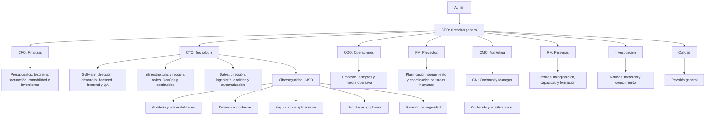

# Veridis como oficina empresarial

Fecha original: 2026-10-22. Actualizado: 2026-10-24. Fase: Arranque. Estado: organigrama, reglas de delegación y planificación departamental implementados. La mayoría de los 56 especialistas sigue operando solo con propuestas (sin ninguna herramienta en `allowedTools`); 20 ya tienen alguna herramienta real — ver [office-architecture.md](office-architecture.md) para cuáles producen un efecto verdadero y cuáles solo proponen.

## Estructura inicial

Adrián mantiene la autoridad humana final. El CEO agente coordina objetivos y departamentos dentro del expediente. Los responsables de área preparan planes para sus equipos, y los especialistas producen entregables revisables. Los títulos identifican responsabilidades de agentes; no conceden facultades de representación, pagos, contratación o acceso a sistemas externos.



El catálogo contiene nueve áreas principales, cuatro subdepartamentos tecnológicos y 56 perfiles de agentes. Se activan cuando el trabajo los requiere. No hay 56 modelos ejecutándose permanentemente, ni todos los encargos tienen que recorrer todos los departamentos.

Cada perfil tiene su carpeta `agents/<id>/` con `instructions.md`, `context.md`, `config.json` y `knowledge/`. Las instrucciones de puesto se incorporan al contexto de sistema; el contexto estable y las referencias declaradas se entregan como datos del propio agente. El [inventario inicial](../agents/INVENTORY.md) queda pendiente de revisar y completar. La identidad, las instrucciones y los modelos pueden evolucionar por separado, conservando su configuración en la huella de compatibilidad del workflow.

## Departamentos y responsabilidades

| Área | Responsable | Especialistas iniciales | Revisión |
| --- | --- | --- | --- |
| Dirección general | `ceo` | Prioridad, estrategia y coordinación entre áreas | Calidad |
| Finanzas | `cfo` | `finance-budget`, `finance-treasury`, `finance-billing`, `finance-accounting`, `investment-research` | `finance-review` |
| Tecnología | `cto` | Responsables de Software, Infraestructura, Datos y Ciberseguridad | Calidad |
| ↳ Software | `software-lead` | `development`, `backend`, `frontend` | `software-qa` |
| ↳ Infraestructura | `infrastructure-lead` | `network`, `devops`, `continuity` | Calidad |
| ↳ Datos y automatización | `data-lead` | `data-engineer`, `data-analyst`, `automation` | Calidad |
| ↳ Ciberseguridad | `ciso` | `security-audit`, `security-defense`, `security-appsec`, `security-governance` | `security-review` |
| Operaciones | `coo` | `operations`, `procurement`, `process-improvement` | Calidad |
| Proyectos | `pm` | `project-planner`, `project-tracker`, `human-task-coordinator` | Calidad |
| Marketing | `cmo`, con `cm` para comunidad | `content`, `social-analyst` bajo CM; `creative-strategy` y `campaigns` bajo CMO | `marketing-review` |
| Recursos Humanos | `hr` | `recruiting`, `onboarding`, `workforce`, `people-development` | `people-review` |
| Investigación | `research-lead` | `research`, `market-research`, `knowledge-curator` | `research-review` |
| Calidad | `quality-lead` | `review` | Revisión independiente de quien produce |

CM significa Community Manager y PM significa Project Manager. RH queda como departamento de personas, separado de operaciones y finanzas. La calidad de un informe financiero, de red o de personas requerirá casos de evaluación y herramientas del dominio antes de usarlo en una operación real.

## CEO, responsables y especialistas

El workflow usa el CEO del organigrama como identidad de coordinación y selección de modelos. Su rol de sistema sigue siendo `coordinator`: esa es la autoridad que puede modificar el plan global, resolver bloqueos entre áreas y cerrar o pausar el expediente. El organigrama guardado identifica qué agente ocupa esa responsabilidad.

La decisión `delegate` contiene un responsable, un encargo y las tareas externas pertinentes en `dependsOn`. El runtime verifica que sea un responsable subordinado del CEO con la capacidad `department.plan`. Consulta su modelo de planificación y espera un plan de una a seis tareas.

El responsable puede asignar a integrantes subordinados de su departamento y subdepartamentos con las capacidades necesarias. `parentDepartmentId` declara el área padre; se rechazan padres ausentes, ciclos departamentales y reportes que crucen áreas hermanas. Cada responsable de subdepartamento debe depender por su cadena de reporte del responsable del área padre. La autoridad sigue la cadena real de responsables, no solo la pertenencia a un área. Por ejemplo, CTO puede asignar desarrollo o infraestructura; CFO no puede asignar desarrollo; CM puede asignar contenido o analítica social. El CEO puede asignar tareas sencillas directamente o pedir un plan al CM sin ejecutar primero una reunión con el CMO.

Cada decisión ejecuta una ronda de planificación departamental. Los responsables devuelven propuestas de tareas; no mantienen conversaciones privadas ilimitadas ni crean recursivamente nuevos responsables. La coordinación general decide la siguiente ronda, incluyendo encargos posteriores al CM u otro responsable.

El plan se valida y registra como un solo cambio del workflow: si una tarea del plan es inválida, no se conserva ninguna de ese plan. Los eventos identifican al responsable que asignó cada tarea. El sistema deriva `departmentId` y `accountableAgentId` desde el registro; el modelo no puede inventar esos campos. Los límites globales de tareas, pasos, decisiones y correcciones continúan aplicando.

## Apoyo entre áreas y revisión

Un especialista que necesita otra área emite `request_support`. El CEO puede pedir un plan al responsable pertinente y enlazar sus resultados como dependencias de la tarea original. El expediente sigue siendo compartido para el objetivo, con entregables y trazabilidad de las asignaciones.

El contexto de un responsable contiene su equipo, las tareas existentes de ese equipo y las dependencias externas que el CEO compartió expresamente. No puede añadir dependencias sobre tareas externas no compartidas. Las dependencias nuevas dentro de un plan deben referir a tareas anteriores del mismo plan; las dependencias circulares se rechazan.

Una tarea pasa por revisión antes de completarse. El revisor debe ser distinto del autor, tener `work.review` y pertenecer al mismo departamento o al área de Calidad. La comprobación ocurre antes de enviarle el contenido al adaptador de revisión y también al registrar su evaluación. Los responsables de área no pueden declarar completado el expediente global mediante una respuesta de planificación.

Estos controles regulan la coordinación. Todavía no sustituyen autenticación, políticas de confidencialidad por departamento o permisos por recurso. La API multiusuario y los controles de acceso a datos siguen pendientes; los cargos por sí solos no habilitan herramientas.

## Modelos por puesto y actividad

La política existente también se aplica a los responsables. El CEO usa la etapa `coordinate` con capacidad `company.strategy`. Los responsables usan `coordinate` con `department.plan`. Los especialistas usan `execute` con su capacidad concreta y los revisores usan `review` con la capacidad de la tarea revisada.

Esto permite configurar modelos distintos para CEO, CFO, CTO, PM, RH y CM, además de cambiar de modelo dentro de un especialista según su actividad. La plantilla `config/models.example.json` incluye ejemplos para esos puestos. Los perfiles son configurables y no implican una recomendación de precio o calidad de un modelo particular.

Los perfiles conservados usan `2.1.0`; los nuevos o modificados en esta ampliación usan `2.2.0` y la firma del adaptador es `office-model-adapter.v3`. La huella del workflow incluye el organigrama, reglas, contexto y referencias declaradas: los trabajos con registros anteriores requieren migración o un expediente nuevo. No se migraron checkpoints existentes automáticamente.

## Simulación y comandos

```bash
npm run office:organization
npm run office:company-demo
```

La simulación sigue este objetivo: preparar un plan para una herramienta interna. El CEO pide diseño al CTO, estructura de costos ficticia al CFO e integración de la entrega al PM. Cada responsable asigna a su especialista; el plan de costos depende del técnico y el plan de entrega depende de ambos. Los revisores correspondientes evalúan sus resultados antes del cierre.

No se realizan llamadas de pago, consultas web, auditorías de red, movimientos financieros ni acciones de RH. La simulación prueba la coordinación y sus contratos con contenido ficticio. Las pruebas automatizadas cubren jerarquía, ciclos, límites de delegación, planes atómicos, revisión por área y modelos distintos para responsables. PostgreSQL y proveedores reales siguen pendientes de validación.

## Archivos y extensiones

- `agents/`: puestos, instrucciones, contexto, capacidades y referencias declaradas.
- `src/office/agent-files.ts`: carga y validación de los perfiles editables.
- `src/office/company-catalog.ts`: departamentos y carga del catálogo desde `agents/index.json`.
- `src/office/organization.ts`: validación del organigrama, equipos y ámbito de delegación y revisión.
- `src/office/engine.ts`: reglas de asignación y campos derivados de las tareas.
- `src/office/workflow.ts`: planificación de departamento integrada con LangGraph.
- `src/office/company-demo.ts`: escenario de colaboración entre Tecnología, Finanzas y Proyectos.

Para incorporar otra área, se define su responsable, misión, especialistas, capacidades y revisión. El arranque propuesto conserva esta estructura acotada; comercial, atención a clientes o producción audiovisual podrán añadirse con los primeros encargos que justifiquen esos roles.


## Trabajo conjunto con empleados y encargados de área

`human-task-coordinator`, bajo PM, prepara y sigue asignaciones para personas reales confirmadas, incluyendo encargados de área. `workforce`, bajo RH, concilia roles, disponibilidad y carga; `people-development` atiende formación. Cada responsable de área aporta prioridades, insumos y validación, y PM resuelve dependencias de entrega. Los perfiles de agentes no se usan como identidades de empleados.

El [contrato del coordinador humano](../agents/human-task-coordinator/instructions.md) exige responsable humano identificado o por confirmar, objetivo, criterios, fecha y zona horaria, dependencias, aceptación, evidencia y seguimiento. La tarea del agente de preparar una asignación puede completarse mientras la ejecución humana permanece pendiente. Un informe generado no demuestra que una persona aceptó o terminó el trabajo.

Por ahora este seguimiento se expresa en entregables: el motor sigue asignando `WorkTask` a agentes. Quedan pendientes el directorio de empleados y encargados, contratos y almacenamiento de tareas humanas, aceptación autenticada, permisos sobre datos de personal y canales de aviso. No se han creado empleados ficticios ni enviado notificaciones.

## Criterio para ampliar la oficina

Cada bloque se desglosa cuando tiene una responsabilidad distinta, entradas identificables y un entregable verificable. Se separan dirección, ejecución y revisión; se define quién coordina el trabajo humano. Las colaboraciones entre áreas pasan por dependencias y responsables, evitando duplicar funciones. Los modelos siguen siendo seleccionables por agente, etapa y capacidad; ampliar el organigrama no activa modelos ni herramientas automáticamente.

La investigación de inversiones prepara análisis con fuentes, horizonte, escenarios y riesgos; la decisión y cualquier movimiento quedan en el responsable humano autorizado. Las evaluaciones de ciberseguridad requieren alcance y activos autorizados; los perfiles actuales no acreditan conexión a sistemas o auditorías ejecutadas.
