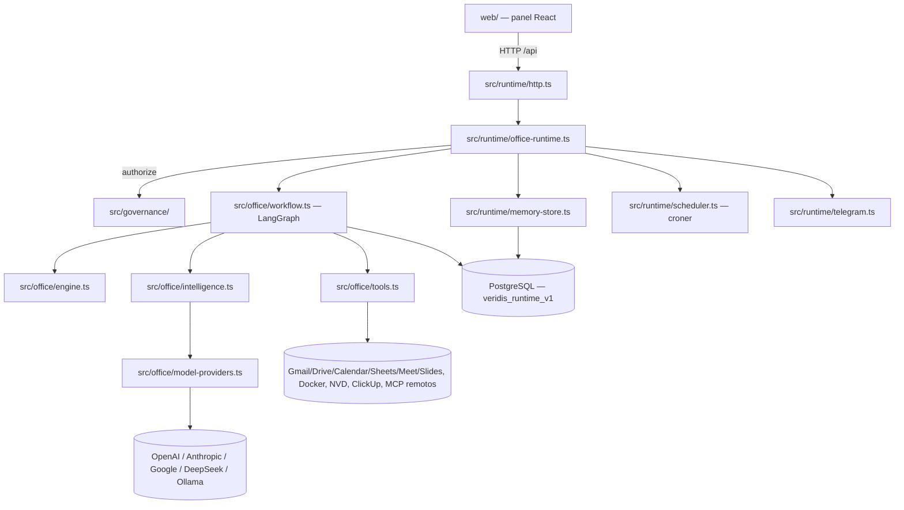
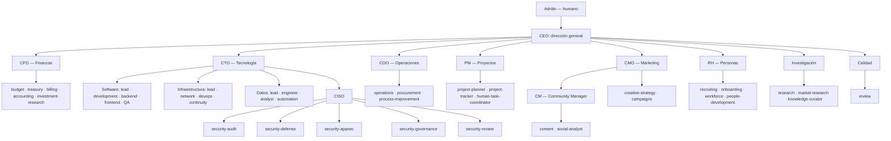
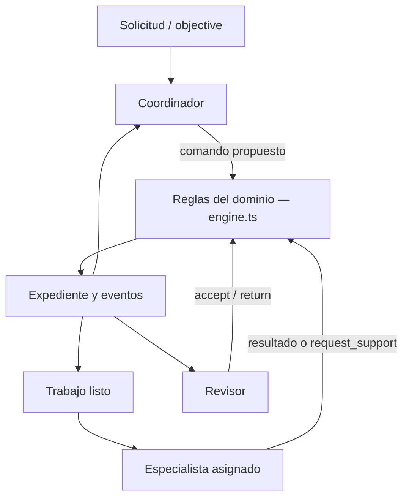
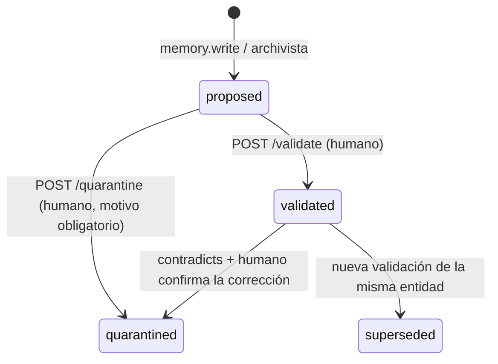

# Documento maestro — VeridisCorp

> Actualización 2026-11-05: este documento sintetiza un commit anterior. El catálogo actual
> tiene 57 perfiles. El despliegue, reparaciones, permisos locales e integración con Core
> verificados están en [operacion-core-2026-11-05.md](operacion-core-2026-11-05.md).

Fecha de elaboración: 2026-11-03. Fuente: lectura completa del repositorio `VeridisCorp/` (código,
`docs/`, `agents/`, `config/`, `test/`, `web/`) en el estado del commit `46ab759`. Este documento es
una síntesis de referencia, no una fuente nueva de verdad — ante cualquier contradicción, manda el
código y los documentos individuales citados en cada sección.

Convención heredada de `AGENTS.md` del proyecto CODE: backlinks `[[tema]]` para Obsidian, tags al
final. Este documento no sustituye `README.md` ni los documentos de `docs/`; los reorganiza en un
solo recorrido completo, departamento por departamento y pieza por pieza, para quien necesite el
panorama entero sin saltar entre doce archivos.

---

## 1. Qué es VeridisCorp, en una página

**VeridisCorp** es el ecosistema empresarial de agentes de IA de **Grupo 642** (642 Studio y marcas
asociadas), construido sobre un motor propio llamado **Veridis**: *Virtual Engine for Realtime
Integration of Data, Information, and Systems*. No es un wrapper sobre CLIs de terceros (Claude
Code, Codex, Gemini CLI) ni un orquestador de texto libre: es un motor propio en TypeScript sobre
**LangGraph**, con contratos **Zod** estrictos y versionados, que coordina hasta 56 perfiles de
agente organizados como una empresa real (CEO, direcciones de área, especialistas, revisores).

Fase declarada del proyecto: **Arranque** (no Implementación ni Ejecución — ver la metodología de
fases en `AGENTS.md` del proyecto CODE). Esto importa para leer todo lo que sigue: la mayoría de las
piezas están implementadas y verificadas con Postgres real y, en partes crecientes, con proveedores
de IA reales — pero el conjunto sigue siendo un piloto acotado, no una plataforma de producción con
login multiusuario, TLS, roles de base de datos separados ni facturación conciliada.

Autoridad humana final: **Adrián Yépiz**. Ningún agente, título o perfil concede por sí mismo
representación legal, acceso a pagos, contratación o permisos sobre sistemas externos — ver
[[organigrama-veridiscorp]].

### 1.1 Las dos rutas que conviven en el mismo repositorio

1. **Piloto de contenido gobernado** (`runtime/`, `/runs/*`): una receta determinista y acotada —
   borrador → revisión → aprobación humana → ejecución → entrega a un receptor HTTP — pensada para
   demostrar gobierno real de punta a punta (autorización, Postgres, presupuesto, recuperación tras
   caída) con el menor número de piezas móviles.
2. **Oficina real** (`office/`, `/office/*`, activada con `VERIDIS_OFFICE_ENABLED=true`): el CEO
   agente coordina expedientes libres (`objective` en lenguaje natural) usando el organigrama
   completo de 56 perfiles, con IA real, Postgres real y, para los agentes que tienen herramientas
   reales en `allowedTools`, efectos verdaderos (un correo, un PDF, un evento de calendario, una
   conexión MCP). Esta es la ruta que usa el panel web día a día (pantallas ASISTENTE y OFICINA).

Ambas comparten el mismo módulo de gobierno (`src/governance/`) como único punto de autorización.
Las entradas CLI antiguas de ejecución real (`run`, `resume`, `office:run`, `office:resume`,
`office:answer`) están **suspendidas** a propósito, para que no exista una ruta alterna sin los
controles nuevos.

---

## 2. Arquitectura por capas



### 2.1 Organización del código (según `README.md`)

| Carpeta | Contenido |
| --- | --- |
| `src/runtime/` | API HTTP, sesiones, repositorios PostgreSQL, flujo gobernado del piloto de contenido, catálogo de capacidades, conector de entrega, memoria corporativa, scheduler, puente de Telegram. |
| `src/governance/` | Contratos y reglas deterministas de identidad, acceso, permisos, aprobaciones, trabajo humano y recuperación — independientes de cualquier motor concreto. |
| `src/office/` | El motor de oficina en sí: protocolo coordinar/despachar/ejecutar/revisar/delegar, registro de agentes, organigrama, selección de modelos, herramientas reales (`tools.ts`), simulaciones y CLI. |
| `src/graph.ts` | Flujo secuencial original, conservado solo por compatibilidad de checkpoints antiguos. |
| `agents/` | Los 56 perfiles editables (instrucciones, contexto, config, knowledge) — no concede permisos por sí mismo. |
| `config/` | Plantillas de política de modelos (`models.*.json`), precios (`prices.*.json`), proxy (`Caddyfile.example`), túnel (`cloudflared-config.example.yml`), sesión de aprovisionamiento. |
| `test/` | Pruebas unitarias, de integración con Postgres real, y el catálogo de escenarios por agente. |
| `web/` | Panel React (Vite + TypeScript) que consume la API. |
| `docker/pdf-renderer/` | Imagen Docker propia (WeasyPrint) para `pdf.generate`. |
| `scripts/` | Utilidades de humo (`live-model-smoke.ts`, `live-office-smoke.ts`), receptor de entrega local, arranque de Postgres temporal para pruebas. |

### 2.2 Stack técnico

- **Lenguaje**: TypeScript estricto (`tsc --noEmit` como gate, ejecución con `tsx`), Node.js ≥ 22,
  módulos ESM (`"type": "module"`).
- **Orquestación de agentes**: `@langchain/langgraph` + `@langchain/langgraph-checkpoint-postgres`
  (checkpoints reales en Postgres, no solo en memoria).
- **Adaptadores de modelo**: `@langchain/openai`, `@langchain/anthropic`, `@langchain/google`
  (`ChatGoogle` de `@langchain/google/node`).
- **Validación**: `zod` (contratos de dominio) + `ajv` (JSON Schema de herramientas MCP y de
  entrada/salida HTTP).
- **Base de datos**: `pg` (cliente nativo) + `pgvector` (embeddings de memoria corporativa).
- **Cron**: `croner` para tareas programadas.
- **MCP**: `@modelcontextprotocol/sdk` para conectar servidores MCP remotos como herramientas.
- **2FA / OAuth**: `otplib` (TOTP), `google-auth-library` (OAuth2 de Gmail/Drive/Calendar/Sheets/Meet/Slides).
- **Frontend**: React + Vite + TypeScript, `d3-hierarchy`/`d3-shape` para el organigrama en grafo,
  Canvas 2D propio para el mapa de memoria (sin librería de grafos 3D).

---

## 3. La organización empresarial — 56 perfiles

Ver [[organigrama-veridiscorp]], `docs/company-organization.md` y `agents/INVENTORY.md`.

### 3.1 Estructura jerárquica



### 3.2 Los 12 departamentos / áreas

| Área | Responsable | Especialistas | Revisor |
| --- | --- | --- | --- |
| Dirección general | `ceo` | — | `quality-lead` |
| Finanzas | `cfo` | `finance-budget`, `finance-treasury`, `finance-billing`, `finance-accounting`, `investment-research` | `finance-review` |
| Tecnología (paraguas) | `cto` | — | `quality-lead` |
| ↳ Software | `software-lead` | `development`, `backend`, `frontend` | `software-qa` |
| ↳ Infraestructura | `infrastructure-lead` | `network`, `devops`, `continuity` | `quality-lead` |
| ↳ Datos y automatización | `data-lead` | `data-engineer`, `data-analyst`, `automation` | `quality-lead` |
| ↳ Ciberseguridad | `ciso` | `security-audit`, `security-defense`, `security-appsec`, `security-governance` | `security-review` |
| Operaciones | `coo` | `operations`, `procurement`, `process-improvement` | `quality-lead` |
| Proyectos | `pm` | `project-planner`, `project-tracker`, `human-task-coordinator` | `quality-lead` |
| Marketing | `cmo` / `cm` | `content`, `social-analyst` (bajo CM); `creative-strategy`, `campaigns` (bajo CMO) | `marketing-review` |
| Recursos Humanos | `hr` | `recruiting`, `onboarding`, `workforce`, `people-development` | `people-review` |
| Investigación | `research-lead` | `research`, `market-research`, `knowledge-curator` | `research-review` |
| Calidad | `quality-lead` | `review` | revisión independiente de quien produce |

Candidatas explícitamente **no incluidas todavía**: ventas, atención al cliente, legal, producción
audiovisual — se añadirán "con los primeros encargos que justifiquen esos roles" (`company-organization.md`).

### 3.3 Anatomía de un perfil (`agents/<id>/`)

```text
agents/<id>/
  config.json       # id, versión, nombre, capabilities, allowedTools, posición en organigrama
  instructions.md    # responsabilidades, reglas y forma de trabajar → system prompt
  context.md         # datos estables confirmados, lo que falta → contexto separado de las reglas
  knowledge/          # hasta 10 documentos de referencia declarados en config.json
    README.md
```

| Archivo | Límite | Uso |
| --- | --- | --- |
| `instructions.md` | 16.000 bytes | Se incorpora al prompt de sistema del puesto. |
| `context.md` | 16.000 bytes | Se entrega como contexto propio, separado de las reglas. |
| `knowledge/*` | 10 docs × 32.000 bytes, 64.000 bytes totales | Solo las referencias declaradas en `config.json`; `.md`, `.txt`, `.json`; se leen al iniciar el proceso (su hash entra en la huella del checkpoint); no hay exploración automática ni búsqueda semántica todavía. |

Ejemplo real (`agents/ceo/config.json`): capacidades `company.strategy`, `company.prioritize`,
`department.plan`; `allowedTools: ["memory.write", "memory.query"]`; dos documentos de knowledge
(`autoridad-y-revision.md`, `cadencia-de-direccion.md`).

Carga y privacidad de contexto: el coordinador y los responsables reciben **metadatos** de los demás
agentes (quién existe, qué capacidad tiene), nunca sus instrucciones, contexto privado ni
documentos — reduce contexto innecesario, no sustituye controles de acceso para una API
multiusuario (pendientes).

Versionado: perfiles originales en `2.1.0`; los ampliados en la ronda de inventario usan `2.2.0`,
firma de adaptador `office-model-adapter.v3`. Cambiar reglas, contexto o knowledge cambia la huella
del registro (`registry.list()` fingerprint) y bloquea reanudar silenciosamente un expediente
anterior — exige migración explícita o expediente nuevo.

### 3.4 Conocimiento de puesto (`knowledge/`) — qué sabe cada agente

Estado (2026-11-01): **103 documentos en 55 de 56 puestos** (falta `investment-research`),
adaptados de **ocho bibliotecas externas con licencia que lo permite** (MIT en su mayoría; CC BY 4.0
con atribución en una; nunca GPL/AGPL/"Unknown"/vendor), nunca copiados literalmente — resumidos y
adaptados al español y al contexto mexicano (SAT/CFDI, LFT, IMSS, LFPDPPP, PROFECO, COFEPRIS,
moneda MXN). Atribución en la primera línea de cada documento y en `docs/third-party-notices.md`;
el detalle completo de qué se tomó de cada biblioteca, por puesto, está en
[[skills-libraries-veridiscorp]] (`docs/skills-libraries.md`).

Bibliotecas fuente: `marketingskills` (Corey Haines, MIT — 16 documentos de marketing),
`headcount` (fuente principal fuera de marketing — una "empresa de agentes" de 16 departamentos),
`n8n-skills`, `claude-skills`, `goose-skills`, `agentic-awesome-skills`,
`DevOps-Security-Agent-Skills`, `agent-skills`, `pm-skills`.

Lo legal/fiscal mexicano va solo en términos generales marcados "verificar con el contador/abogado":
ninguna biblioteca lo cubre con la profundidad necesaria. Facturación CFDI es documento propio,
escrito desde cero.

Cada documento de marketing exige a su agente **buscar la ficha de marca antes de proponer** (ver
§12) y **marcar `FALTANTE`** lo que no tenga, en vez de inventarlo o estimarlo — guardarraíl
verificado por `test/agent-scenarios.test.ts` (ver §13.6).

---

## 4. El protocolo del motor — quién decide, cómo pasa el turno

Ver [[protocolo-veridis-office]] y `docs/office-architecture.md`.

### 4.1 Núcleo de dominio (`src/office/contracts.ts`, `registry.ts`, `engine.ts`)

- `contracts.ts` define esquemas Zod estrictos y versionados para expediente (`WorkOrder`), tarea
  (`WorkTask`), evidencia, criterios, revisiones, actores y comandos.
- `registry.ts` registra agentes por identidad y capacidades — **sin un enum cerrado**: un agente
  nuevo se añade registrando su definición, no modificando un tipo fijo.
- `engine.ts` valida cada transición mediante una **función pura** (sin IA, sin red): dado el
  expediente actual y un comando propuesto, decide si es válido y cuál es el nuevo estado.
- `demo.ts` recorre un caso de colaboración completo con bloqueo, apoyo, corrección y cierre, sin
  IA ni red — para probar el núcleo aislado.

Cada expediente pertenece a un `workspaceId`; tiene objetivo, criterios y límites (`rigor`, ver
§4.4). El número de revisión aumenta con cada comando aceptado. Un evento conserva actor + comando
para historial completo, aunque la tarea solo guarde la última propuesta.

### 4.2 Ciclo coordinar → ejecutar → revisar



### 4.3 Comandos y actores permitidos

| Comando | Actor permitido | Efecto |
| --- | --- | --- |
| `add_task` | Coordinador o responsable autorizado | Crea tarea con responsable capaz y dependencias válidas |
| `start_task` | Especialista asignado | Comienza si las dependencias están completadas |
| `request_support` | Especialista asignado | Registra pregunta y capacidad requerida; bloquea la tarea |
| `resolve_block` | Coordinador | Documenta resolución; puede añadir dependencias de apoyo |
| `submit_result` | Especialista asignado | Entrega evidencias; pasa a `in_review` |
| `review_task` | Otro agente con capacidad de revisión | Acepta o devuelve con observaciones |
| `close_order` | Coordinador | Cierra si tareas y criterios están completos |
| `pause_order` | Coordinador | Pausa con motivo registrado |

Estados de tarea: `pending → running → in_review → completed`, con rama a `blocked` (falta apoyo) y a
`failed` tras agotar correcciones. No se puede cerrar el expediente con tareas `failed`, `blocked`
o `pending`.

### 4.4 Niveles de rigor (`src/office/rigor.ts`)

| Nivel | `maxTasks` | `maxSteps` | `maxRevisionsPerTask` | Uso previsto |
| --- | --- | --- | --- | --- |
| `minimal` | 10 | 200 | 2 | Encargo acotado, bajo riesgo |
| `standard` (default) | 40 | 2000 | 5 | Mayoría de encargos departamentales |
| `full` | 100 | 10000 | 20 | Iniciativas grandes multi-área |

Un `limits` explícito siempre gana sobre el preajuste del nivel. El nivel resuelto se guarda como
metadato informativo en `WorkOrder.rigor`; no concede permisos ni sustituye `maxCostMicros`.

### 4.5 Delegación departamental

La decisión `delegate` del coordinador asigna un responsable + encargo + `dependsOn`. El runtime
verifica que el destinatario sea responsable subordinado del CEO con capacidad `department.plan`.
El responsable puede asignar a su equipo y subdepartamentos; `parentDepartmentId` declara el área
padre, se rechazan padres ausentes, ciclos y reportes cruzados entre áreas hermanas. La autoridad
sigue la **cadena real de responsables**, no solo la pertenencia a un área (ej.: CFO no puede
asignar a Desarrollo aunque ambos reporten al CEO).

Cada ronda de planificación departamental se valida y registra como **un solo cambio atómico**: si
una tarea del plan es inválida, no se conserva ninguna del plan completo.

### 4.6 Apoyo entre áreas y revisión

`request_support` permite a un especialista pedir ayuda de otra área; el CEO enlaza el resultado
como dependencia. El revisor debe ser **distinto del autor**, tener `work.review` y pertenecer al
mismo departamento o a Calidad. Para encargos ambiguos o creativos (marketing), la plantilla de
puesto espera 2–4 opciones con trade-offs antes del entregable final — convención de redacción, no
regla que el motor imponga.

### 4.7 Integración con LangGraph

El flujo es: observar expediente → proponer decisión → validar reglas → ejecutar/revisar → volver
al coordinador. Las identidades se construyen en el runtime desde la asignación; el modelo **nunca**
puede incluir un `Actor` en su respuesta. Checkpoints en cada nodo; preguntas humanas usan
`interrupt()` + `Command({resume})`. Tres rechazos acumulados pausan el expediente por defecto.
Límites del runtime: 100 decisiones y 5 preguntas por defecto, además de los límites del expediente.

`src/graph.ts` (flujo secuencial original) sigue disponible solo por compatibilidad de checkpoints
antiguos; la oficina usa otro workflow con prefijo `office.v1:` para no reinterpretarlos.

---

## 5. Selección de modelos (`model-routing.md`)

Ver [[modelos-veridis-office]].

### 5.1 Principio

El agente define responsabilidades y permisos; **el modelo es un recurso seleccionado por
intervención**, no una propiedad fija del agente. Un mismo agente puede usar modelos distintos
según la capacidad de la tarea y la etapa (`coordinate`, `execute`, `review`).

### 5.2 Prioridad de resolución

1. Regla para etapa + agente + capacidad exactos.
2. Regla para etapa + capacidad, sin agente específico.
3. Perfil del agente para esa etapa.
4. Perfil general de la etapa.
5. Perfil general de la oficina.

### 5.3 Política activa real (`config/models.active.json`)

| Perfil | Proveedor / modelo | Uso |
| --- | --- | --- |
| `routine` | DeepSeek Flash (compatible OpenAI), jsonMode, 16.000 tok, 90 s | Borradores y contenido sencillo |
| `deepseek-code` | DeepSeek Flash, 4.000 tok | Implementación de software |
| `analysis` | DeepSeek-v4-pro, thinking habilitado | Investigación, análisis financiero y de datos |
| `review` | GPT-5.4 Mini (functionCalling, esfuerzo none) | Revisión habitual y coordinación de proyectos |
| `complex` | GPT-5.4 (functionCalling, esfuerzo medium) | Dirección, arquitectura, revisión de mayor riesgo |
| `gemini-flash` | Gemini 3.8 Flash | Piloto de diversidad de proveedor (definido, sin asignar — cuota agotada) |
| `uncensored` | Ollama `qwen3-coder-abliterated:30b` local | **Reservado a ciberseguridad** (ejecución y revisión) |
| `local-general` | Ollama `qwen3-abliterated:8b` local | Especialistas `specialist` sin herramientas reales |
| `search-google` | Gemini 3.8 Flash | Google Search nativo para `web.search` |
| `claude-reasoning` | Anthropic (`CLAUDE_API_KEY`/`CLAUDE_MODEL`, ej. `claude-opus-5-5`) | **Coordinación del CEO** — único nodo que arbitra entre todas las áreas |
| `claude-review` | Anthropic (`CLAUDE_API_KEY_2`/`CLAUDE_MODEL_2`, ej. `claude-haiku-5-5`) | Revisor genérico (`review` agente) — proveedor distinto al resto, por independencia |

Reglas especiales notables:

- Desarrollo (`development`, `backend`, `frontend`) implementa con `deepseek-code`, documenta con
  `routine`, diseña con `analysis`.
- Seguridad (`security.audit/appsec/incident/defense/governance/access`) ejecuta **y revisa** con
  `uncensored` (modelo local sin censura comercial) — decisión explícita para no mandar detalles de
  explotación a un proveedor externo y para evitar los filtros de un modelo comercial.
- `content.execute` y `research.execute` subieron a `analysis` por tener herramientas de efecto real
  (siete en el caso de `content`, incluida `calendar.create_event` que notifica de inmediato).
- `campaigns`, `creative-strategy`, `social-analyst`, `automation` corrieron primero en
  `local-general` (8B, tope 2.000 tok) y fallaron en producción real — se movieron a `routine`
  (DeepSeek, tope subido a 8.000 tok / 90 s) tras verificarlo en vivo (ver §13.5).
- Dos claves de Anthropic distintas para CEO y revisor genérico: así una cuota agotada en una no
  bloquea a la otra, y el consumo queda separado en `byApiKeyEnv`.

### 5.4 Adaptadores y garantías

- `openai`: `ChatOpenAI`, soporta `baseURL` (usado para DeepSeek y Ollama, ambos compatibles OpenAI).
- `anthropic`: `ChatAnthropic`.
- `google`: `ChatGoogle` (`@langchain/google/node`), sin soporte Vertex/ADC.
- Sin fallback automático entre proveedores: un error queda pendiente para continuación explícita.
- El runtime desactiva reintentos automáticos del adaptador (`maxRetries: 0` en todos los perfiles)
  para que cada intento quede registrado desde el servicio, no oculto dentro del SDK.
- La huella de la política resuelta (proveedores, modelos, parámetros, nombres de variable — nunca
  valores de clave) se guarda junto al checkpoint; cambiarla bloquea reanudar sin migración.

### 5.5 Validaciones en vivo documentadas

- Acceso confirmado a los cuatro proveedores (OpenAI, Anthropic, DeepSeek, Gemini).
- Tres fallas reales encontradas y corregidas en la primera corrida con `office/` real (ver
  `model-routing.md` §"Validación en vivo"): (1) OpenAI rechaza uniones discriminadas en modo
  `jsonSchema` estricto → se movió a `functionCalling`; (2) el modelo anidaba mal
  `delegate/dispatch/review/ask_user` dentro de `command` → corregido en `intelligence.ts`; (3) una
  respuesta real con forma inválida tumbaba toda la ejecución → ahora se distingue `ZodError`/
  `OutputParserException` (se reintenta) de cualquier otro error (se propaga sin tocar, para no
  interferir con la recuperación por checkpoint).
- Perfil local `local-code` (30.5B, Q4_K_M) confirmado en vivo generando una función TypeScript
  válida en 14.5 s.

---

## 6. Herramientas reales — qué puede hacer cada agente de verdad

Ver [[herramientas-veridis-office]] y `docs/office-architecture.md` §"Protocolo y autoridad".

`allowedTools` en `agents/<id>/config.json` es el único catálogo de permisos por agente; `execute()`
solo invoca una herramienta si el agente la declara ahí. **Cualquier falla de herramienta (sin
credencial, cuota, red, Docker apagado, cuenta sin autorizar) se trata como "sin resultado", nunca
como error que tumbe `execute()`.**

De 56 perfiles, **20 tienen alguna herramienta real**; los otros 36 solo producen propuestas
(`proposal://`) con la información recibida.

### 6.1 Herramientas de solo lectura / cómputo (`review()` las re-ejecuta de forma independiente)

| Herramienta | Agentes | Qué hace |
| --- | --- | --- |
| `web.search` | `research`, `market-research`, `knowledge-curator` | Cascada: Brave Search real → Google Search nativo (Gemini) → Wikipedia español sin credenciales |
| `calculator` | `finance-*`, `data-analyst` | Evaluador aritmético propio, sin `eval()` |
| `cve.lookup` | agentes de `cybersecurity` | API oficial NIST/NVD, sin credenciales |
| `code.sandbox` | agentes de `software` | Docker efímero `--network none`, tmpfs propio, tope CPU/memoria/tiempo; código por stdin, nunca monta el filesystem del host; soporta JS y TypeScript (`--experimental-transform-types`) |
| `repo.read` | `development`, `backend`, `frontend`, `devops`, `security-appsec`, `security-audit` | `git_log`, `git_show`, `git_diff`, `git_status`, `repo_search`, `repo_read_file`, `repo_list_files` sobre `VERIDIS_REPOS`; `execFile` sin shell, sin textconv/ext-diff, nunca escribe/fetch/checkout/push, solo archivos versionados |
| Knowledge de puesto | casi todos (55/56) | Documentos de `agents/<id>/knowledge/`, íntegros en cada llamada |
| `mcp.connect` / `mcp.use` / `mcp.use.readonly` | `automation`, `devops` (connect); + `development`, `backend`, `research`, `knowledge-curator`, `human-task-coordinator` (use) | Conexión a servidores MCP remotos — ver §7 |
| `clickup.read` | agentes de `projects` | Lista tareas reales de ClickUp por palabra clave, sin escribir |
| `email.read` | `content` | Lee mensajes reales de la cuenta Gmail del sistema, sin modificar |

### 6.2 Herramientas con efecto real (`review()` nunca las re-ejecuta — duplicaría el efecto)

| Herramienta | Qué hace | Agentes con acceso |
| --- | --- | --- |
| `pdf.generate` | PDF real (WeasyPrint en Docker propio), guardado en Postgres, idempotente por `(order_id, input_hash)` | `content`, `market-research`, `research`, `investment-research`, `data-analyst` |
| `email.draft` | Borrador real de Gmail (`users.drafts.create`) — **nunca `send`** | `content` |
| `drive.upload` | Sube archivo real a Drive, scope `drive.file` (solo ve lo que crea) | `content`, `market-research`, `research`, `investment-research`, `data-analyst` |
| `calendar.create_event` | Evento real — **notifica invitados de inmediato** (`sendUpdates: 'all'`), sin revisión humana previa — decisión explícita documentada, no omisión | `content` |
| `sheets.create` | Hoja de cálculo real con datos (scope `spreadsheets`, sin acotar a "solo lo creado") | `data-analyst`, `investment-research` |
| `meet.create_space` | Sala real de Google Meet (API dedicada `meet.googleapis.com/v2/spaces`) | `content` |
| `slides.create` | Presentación real de Google Slides (diseños predefinidos, sin imágenes/tablas aún) | `content`, `market-research` |

Todas comparten **un solo cliente OAuth2** de una cuenta Gmail dedicada del sistema
(`contacto@642studio.com`), autorizada una sola vez vía `npm run runtime:gmail-authorize`. Ampliar
`allowedTools` a más agentes es una línea de `config.json`, sin tocar código.

El error real que generó la regla "nunca re-ejecutar herramientas de efecto": antes de corregirlo,
**cada ronda de revisión de una tarea con `email.draft` creaba un borrador real nuevo** en Gmail. Se
corrigió generalizando la exclusión a toda herramienta de `SIDE_EFFECTING_TOOLS`
(`src/office/intelligence.ts`), no solo a la que lo reveló.

### 6.3 Mecanismo de verificación del revisor

`review()` no confía en que el especialista diga haber usado una herramienta: **vuelve a ejecutar**,
de forma independiente y con credenciales del motor (no las del especialista), las mismas
herramientas de solo lectura permitidas, y pasa el resultado fresco al revisor para comparar.

La comprobación de permiso hoy es solo el id de la herramienta contra `allowedTools` — sin alcance
por recurso ni cuota propia por llamada (las citas quedan en la evidencia redactada, no en un
registro aparte).

---

## 7. Conexiones MCP — el agente como integrador

Ver `docs/office-architecture.md` §"Conexiones MCP" y `docs/competitive-strategy.md` §"Hecho: conexiones MCP con memoria".

- Transportes: solo remotos (Streamable HTTP, o SSE si falla) — **nunca stdio**, porque eso
  ejecutaría un comando en el servidor del agente.
- Un agente solo conecta `https` público: resolución de nombre con rechazo de red privada, loopback,
  Tailscale (`100.64/10`) y metadatos de nube, **en cada petición**. Solo un humano puede conectar su
  LAN (ej. n8n local).
- Clasificación de herramientas: `read` (el servidor declara `readOnlyHint`, nace activa), `write` o
  `unknown` (no declara nada) — un humano activa las que no son `read`, y puede reclasificar una
  `unknown`.
- Validación de argumentos con el esquema que declaró el servidor (Ajv); la respuesta se recorta y
  se tapan cadenas con forma de credencial. Credencial cifrada con `VERIDIS_TOKEN_ENCRYPTION_KEY`.
- Memoria: cada conexión tiene una memoria `integration` / `mcp-<nombre>` reescrita en cada cambio
  (qué es, para qué sirve, cada herramienta, quién la conectó, estado) — la versión nueva sustituye
  siempre a la anterior.
- Pruebas en vivo documentadas: DeepWiki (3 herramientas de lectura, activa), documentación de
  Cloudflare (2 herramientas de lectura, conectada sola por el agente `automation`).
- Pendiente: OAuth de servidores MCP (Notion, GitHub, ClickUp remotos lo piden — hoy solo cabecera
  con token), servidores locales por stdio solo declarados por el operador, y que las respuestas
  observadas sobrevivan a un reinicio de la API (hoy viven en memoria del proceso).

---

## 8. Memoria corporativa — el sistema más elaborado del proyecto

Ver [[memoria-corporativa-veridis]], `README.md` §"Memoria corporativa" y `runtime-pilot.md`
§"Memoria corporativa".

### 8.1 Modelo de datos

`CorporateMemoryRecord`: persistida y **versionada por entidad**, con embebido semántico
(`pgvector`, modelo `nomic-embed-text` vía Ollama local por defecto — para no mandar contenido de
memoria a un proveedor externo) y búsqueda léxica de respaldo (`ts_rank`, peso 0.15 combinado con
distancia coseno, sin calibrar todavía con datos reales).

### 8.2 Estados y ciclo de vida

**Modelo automático desde el 2026-10-31** (decisión explícita de Adrián, tomando como referencia la
app "madre" — ver §14): lo que un agente guarda con `memory.write`, o lo que el **archivista**
destila al cerrar un expediente, queda vigente **sin confirmar** de inmediato y `memory.query` ya lo
usa, marcado como tal. Esto reemplazó un diseño anterior de validación humana obligatoria antes de
cualquier uso.



Salvaguarda central: **algo ya confirmado nunca cae solo** — una corrección que lo refuta
(`contradicts`) solo lo pone en cuarentena cuando un humano confirma también la corrección; una
memoria sin confirmar sí cae al instante si la contradice otra.

### 8.3 El archivista

`OfficeRuntime.distill` (`intelligence.ts`): al cerrar cada expediente, en segundo plano y una sola
vez (`office_orders.memory_distilled_at`), destila hasta 5 memorias (decisión, hecho, preferencia o
pregunta) con el perfil barato de `knowledge-curator`. Su consumo se registra en auditoría
(`memory.distilled`), **fuera** del presupuesto del expediente ya cerrado.

### 8.4 Uso real y mapa de memoria

Cada uso real por un agente se registra en `memory_recalls` y alimenta el **mapa de memoria** de la
pantalla MEMORIA del panel web: una esfera 3D en Canvas 2D propio (sin dependencias externas de
visualización), donde cada memoria es una neurona:

- Color por tipo (3 tonos validados contra el fondo real con el validador de paleta de `dataviz`).
- Forma: segunda codificación.
- Anillo si está confirmada; apagada si está en cuarentena; brillo si se usó en los últimos 7 días.
- Enlaces por similitud de embeddings, coseno ≥ **0.72** (no el 0.6 de "madre" — calibrado en vivo:
  con `nomic-embed-text`, dos textos sin relación ya dan 0.62–0.70), máximo 4 por memoria, más una
  arista por cada contradicción.
- Panel lateral para confirmar/cuarentena desde el propio mapa; respeta `prefers-reduced-motion`.
- La vista LISTA es la alternativa en texto, con las mismas acciones.

### 8.5 Ámbito y exportación

Ámbito **fijo por despliegue** (`VERIDIS_MEMORY_WORKSPACE_ID`/`COMPANY_ID`/`DIVISION_ID`) — sin
aislamiento real por cliente todavía; una sesión de otro ámbito recibe 404.

Con `VERIDIS_MEMORY_VAULT_PATH` configurada, cada validación también escribe
`<entityType>/<entityId>.md` en un **vault de Obsidian**, con el formato exacto de la "Instrucción
permanente para generación de memorias Veridis .md" del proyecto CODE (título, backlinks, tags,
fecha). Postgres sigue siendo la única fuente de verdad: un fallo de escritura a disco no revierte
la validación, queda como `memory.vault_export_failed` en auditoría. `npm run runtime:memory-export`
exporta de una vez todo lo `validated`.

### 8.6 Importar texto a memoria

Pantalla MEMORIA → **+ IMPORTAR TEXTO**: el servidor parte el documento en secciones deterministas
(`src/runtime/memory-ingest.ts`) y cada sección pasa por el perfil barato de `knowledge-curator`,
que devuelve hasta 12 memorias cortas. Prueba real con el contexto maestro de Grupo 642 (28.514
caracteres): 13 secciones → 105 memorias en ~46 s, $0.02, sin `entityId` duplicado.

---

## 9. Gobierno, identidad y autorización

Ver [[gobierno-veridiscorp]] y `docs/governance-foundation.md`.

### 9.1 Separación de responsabilidad

`src/governance/` decide **autorización por identidad, operación, recurso y alcance**,
independiente del cargo organizacional: un PM puede recibir permiso explícito para encargar una
tarea a un agente de otra área sin alterar su jerarquía formal. `src/runtime/office-runtime.ts` usa
`authorize()` para decidir con permisos reales si una sesión puede crear/leer/escribir sobre un
expediente, tarea programada o archivo (`permit()`).

### 9.2 Entidades y acceso

`AccessScope` exige workspace, empresa, división y cliente/proyecto explícitos — `null` significa
"sin cliente", nunca comodín. Acceder desde otro contexto exige **tres condiciones**: relación
vigente (`EntityRelationship`), `ResourceAccessLink` explícito para ese recurso/operación, y permiso
vigente de la identidad sobre el recurso destino. Una relación comercial por sí sola no concede
lectura; no se comparte entre workspaces.

### 9.3 Acciones y aprobaciones

`ActionRequest` vincula identidad, operación, recurso, parámetros, versión, vencimiento y clave de
idempotencia. `actionDigest` es un hash determinista del contenido validado (reordenar claves JSON
no lo cambia; cambiar contenido, destino o versión sí). Una aprobación referencia la **huella
exacta**; solo el humano designado, con permiso de aprobar y autoridad sobre esa operación concreta,
puede aceptar, rechazar o revocar. Antes de ejecutar se comprueban de nuevo permisos del ejecutor y
del aprobador.

Operaciones del enum `Operation` (`src/governance/contracts.ts`): `data.read`, `draft.create`,
`data.write`, `content.publish`, `external.communicate`, `contract.commit`, `people.hire`,
`finance.move`, `task.assign`, `approval.decide`. La política inicial exige aprobación para
modificación de datos, publicación, comunicación externa, contratos, contratación y movimientos
financieros; lectura, borradores y encargos entre agentes requieren permiso sin exigir aprobación
humana adicional.

### 9.4 Capacidades, trabajo humano, eventos y recuperación (contratos listos, repositorio pendiente)

- `CapabilityDefinition`/`CapabilityCatalog`: descriptores de capacidad con JSON Schema de
  entrada/salida, riesgos y criterios de éxito — todavía no validan cargas reales ni seleccionan
  candidatos por costo/calidad.
- `HumanTask`: asignado y aprobador humanos, criterios, dependencias, evidencia — sin directorio de
  empleados ni persistencia real todavía (ver §10).
- `BusinessEvent`: tipo, origen, ámbito, correlación, deduplicación — sin bus ni triggers.
- `ExternalOperation` + `planExternalRecovery`: decide consultar al proveedor o conciliar cuando el
  proceso se interrumpe tras enviar una operación — probado con resultado incierto simulado, no con
  reinicio contra un proveedor real.
- `UsageRecord`/`ExecutionBudget`: cada intento (incluidos fallos) con costo/tokens o `null` si se
  desconoce. `BusinessOutcome`: tiempo ahorrado, ingresos, margen — distingue observación, estimación
  y experimento; "consumir pocos tokens no demuestra valor generado".
- `CredentialBinding`: valida solo una referencia `vault://`, no resuelve secretos — no hay bóveda
  conectada todavía.

### 9.5 Secuencia de implementación planeada (6 fases, `governance-foundation.md`)

1. Identidad y autorización (repositorios reales, catálogo de capacidades del piloto).
2. Ejecución durable (tablas de aplicación, diario, outbox, eventos, recuperación).
3. Aprobaciones y herramientas (servicio de aprobación, artefactos versionados, idempotencia).
4. Memoria y trabajo humano (entidades compartidas, decisiones vigentes, directorio).
5. Costos y evaluación (medición y reservas de presupuesto, KPIs de negocio).
6. Procesos y departamentos (workflow por división, disparado también por eventos).

---

## 10. El piloto de contenido gobernado — recorrido end-to-end

Ver [[piloto-contenido-veridis]] y `docs/runtime-pilot.md`.

### 10.1 Los 8 pasos del recorrido implementado

1. Sesión opaca (token hasheado en Postgres, con vencimiento y revocación) identifica persona y
   ámbito — la solicitud **nunca** elige su propia identidad.
2. Se verifica permiso y capacidad para asignar `content.draft` a `content`; se crea expediente y
   tarea persistentes.
3. Un grafo LangGraph ejecuta generación y revisión independiente. Cada llamada reserva presupuesto
   y registra el intento **antes** de contactar al proveedor. Entradas/salidas validadas con Ajv
   contra JSON Schema y contra los contratos del piloto.
4. El contenido se guarda como artefacto versionado con hash. La revisión aceptada crea una
   solicitud de aprobación — **la revisión del agente no autoriza la entrega por sí sola**.
5. Un humano designado decide desde su sesión, con autoridad de aprobación y publicación. La
   aprobación referencia la huella exacta (versión + hash).
6. El ejecutor central reverifica permisos (humano y de servicio), aprobación vigente, versión e
   integridad; reserva presupuesto, registra la operación, cambia estado a `dispatching` en una
   transacción corta antes de enviar.
7. El conector entrega a un receptor configurado por el operador — **nunca** un destino que venga
   del modelo o de la solicitud de usuario.
8. Si el resultado es incierto, se consulta al receptor por clave y hash; no se reenvía por un 404 o
   una respuesta perdida.

### 10.2 Garantías de concurrencia y recuperación

Esquema separado `veridis_runtime_v1` (sesiones, grants, expedientes, tareas, versiones,
aprobaciones, intentos, operaciones, auditoría). Cambios de expediente serializados con bloqueo de
fila y transacciones cortas — **nunca** una transacción abierta durante llamadas a modelo o
conector. Dos ejecuciones simultáneas no pueden reclamar la misma versión (una registra
`dispatching`, la otra se rechaza); la clave de operación es única en la base.

**Probado con interrupción real de proceso**: el receptor guarda la entrega, el proceso muere antes
de registrar la respuesta, otro proceso (misma base) espera el vencimiento de la reserva, consulta
al receptor y finaliza con un solo envío observado. Sin confirmación posible, el expediente queda
en `outcome_unknown` para conciliación manual — una nueva petición de ejecutar se rechaza. Esto
**no** es garantía de exactamente-una-ejecución para cualquier proveedor; no hay reenvío automático,
outbox general ni compensaciones ejecutables todavía.

### 10.3 Presupuesto y límites (`Defaults`, `src/runtime/contracts.ts`)

Conservador a propósito: **15 minutos** de plazo, **6** llamadas de modelo, **3** de herramienta,
**$0.10** de tope. Vencido el plazo, cualquier acción que reserve presupuesto responde `409`. Las
reservas no se liberan al recibir un error o costo desconocido. Variables de entorno
(`VERIDIS_MAX_DURATION_MS`, `VERIDIS_MAX_MODEL_CALLS`, `VERIDIS_MAX_COST_MICROS`,
`VERIDIS_MAX_TOOL_CALLS`) amplían esto solo para expedientes creados **después** de reiniciar con
esos valores.

### 10.4 Rutas HTTP del piloto de contenido

| Ruta | Uso |
| --- | --- |
| `POST /runs` | `{brief, approverHumanId}` — crea expediente y tarea |
| `GET /runs` | Lista del ámbito autorizado; filtro `status`, `limit` (máx. 100), `cursor` opaco |
| `GET /runs/{id}` | Ámbito, versiones, consumo, auditoría |
| `GET /organization` | Organigrama + catálogo de 56 perfiles, sin instrucciones/contexto |
| `GET /agents/{id}` | Perfil completo (instrucciones, contexto, capacidades, herramientas) |
| `POST /agents/{id}/text` | Edita `instructions.md`/`context.md` en disco y recarga sin reiniciar (2026-11-03) |
| `POST /runs/{id}/advance` | Genera o continúa generación/revisión pendiente |
| `POST /runs/{id}/revise` | `{text}` — nueva versión, invalida aprobación afectada |
| `POST /runs/{id}/approve` | `{version, decision, reason?}` — humano designado decide |
| `POST /runs/{id}/execute` | Ejecuta únicamente una versión aprobada |
| `POST /runs/{id}/reconcile` | Consulta una operación incierta sin reenviarla |
| `POST /runs/{id}/regenerate` | Solo sobre versión rechazada; usa texto previo + motivo de rechazo |

---

## 11. La oficina real — expedientes, chat y tareas programadas

Ver `docs/runtime-pilot.md` §"Oficina real".

Con `VERIDIS_OFFICE_ENABLED=true`, reabre la ruta que las entradas CLI tenían suspendida: el **CEO
real** coordina sobre el mismo módulo de gobierno que protege `/runs`. `VERIDIS_OFFICE_MAX_TURNS`
(default 5) es el único tope — sin presupuesto en dólares propio salvo que se configure
`VERIDIS_OFFICE_MAX_COST_MICROS` (ver §11.5).

### 11.1 Rutas de expedientes y chat

| Ruta | Uso |
| --- | --- |
| `POST /office/assistant/ask` | `{question, threadId?}` — respuesta rápida (1 llamada, ~2–3 s); `mode: answer` o `mode: order` (abre expediente) |
| `GET /office/assistant/threads` / `/{id}` | Conversaciones rápidas, con memorias usadas, tokens, costo, latencia |
| `GET/POST /office/connections*` | Gestión de conexiones MCP (ver §7) |
| `POST /office/orders` | `{objective}` — crea y avanza hasta cerrar/pausar/preguntar |
| `GET /office/orders` / `/{id}` | Lista / detalle completo (tareas, eventos, `modelCalls`, `exchanges`, límites) |
| `POST /office/orders/{id}/advance` | Continúa un expediente activo sin pregunta pendiente |
| `POST /office/orders/{id}/answer` | `{answer}` — responde `ask_user` y continúa |
| `GET /office/files/{id}` | Bytes reales de un documento generado (`pdf.generate`) — primera ruta binaria |

Autorización uniforme: `draft.create` para crear/avanzar/responder, `data.read` para listar/consultar
— siempre sobre `workflow/office-pilot`.

La pantalla ASISTENTE se construye **enteramente** sobre estas rutas: no hay streaming real del
backend ni endpoint propio de chat — una sola petición HTTP bloqueante, con el hilo reconstruido en
el navegador desde `objective + exchanges + estado final`.

### 11.2 Tareas programadas (`croner`)

Interruptor propio `VERIDIS_SCHEDULER_ENABLED=true`, `VERIDIS_SCHEDULER_MAX_PER_HOUR` (default 10)
por `scope_key`. Un disparo automático se autoriza como principal de servicio `scheduler`.

Controles verificados contra Postgres real:

- **Candado contra solapamiento**: reclamo atómico (`UPDATE ... WHERE current_order_id IS NULL AND
  enabled RETURNING *`) — única fuente de verdad, sin revisión previa separada que podría tener
  carrera real.
- **Apagado automático**: 3 fallos consecutivos apagan la tarea sola; un `ask_user` pendiente no
  cuenta ni a favor ni en contra.
- **Límite de tasa por `scope_key`**, no global; un salto por límite no cuenta como fallo.
- **Sin recuperación al reiniciar**: un disparo perdido mientras el servidor estaba apagado
  simplemente no ocurre — comportamiento simple elegido a propósito.

| Ruta | Uso |
| --- | --- |
| `POST /office/schedules` | Crea tarea activa, valida cron y zona horaria |
| `GET /office/schedules` / `/{id}` | Lista / detalle, con `nextRunAt` |
| `POST /office/schedules/{id}/update` | Campos parciales, incluido pausar/reactivar |
| `POST /office/schedules/{id}/delete` | Borra (no afecta expedientes ya creados) |
| `POST /office/schedules/{id}/fire` | Disparo manual — misma `fireOnce` que el cron real |

La pantalla TAREAS_PROGRAMADAS no expone cron crudo: un selector Diario/Semanal/Mensual + hora +
zona horaria (autodetectada) se traduce a cron en el cliente; si una tarea tiene un cron que no
coincide con ese patrón (editada a mano en la base), el selector cae a un valor por defecto en vez
de intentar representarlo.

### 11.3 Rutas de memoria corporativa

| Ruta | Uso |
| --- | --- |
| `GET /office/memory?status=proposed|validated|superseded` | Lista por estado (default `proposed`) |
| `POST /office/memory/{id}/validate` | Valida una propuesta, sustituye la versión vigente anterior |
| `POST /office/memory/{id}/quarantine` | Cuarentena manual, motivo obligatorio |
| `GET /office/memory/graph` | Mapa: memorias no sustituidas + enlaces por similitud |

Patrón de autorización: ámbito **fijo para todo el despliegue** (no por expediente) — una sesión de
otro ámbito recibe 404 aunque tenga `approval.decide` en general. Validar dos veces, o una ya
sustituida, responde `409`.

### 11.4 Bot de Telegram

`src/runtime/telegram.ts`: opcional, arranca solo si `office/` está habilitado y
`TELEGRAM_BOT_TOKEN`/`TELEGRAM_ALLOWED_CHAT_IDS` están definidos. Long polling saliente hacia
`api.telegram.org` — no abre puertos nuevos. Actúa con el principal de servicio `telegram-bridge`
(nunca con la identidad de quien escribe), requiere grant explícito. Un `chat_id` no autorizado se
ignora en silencio (queda en logs, nunca se responde). **Pendiente**: hoy abre un expediente por
mensaje; debería usar la misma respuesta rápida del chat ASISTENTE.

### 11.5 Presupuesto por expediente con proyección

`WorkOrder.limits.maxCostMicros` (opcional) se fija al crear cada expediente desde
`VERIDIS_OFFICE_MAX_COST_MICROS` — copiado al expediente, así que cambiar la variable no reinterpreta
expedientes en curso. `src/office/budget.ts` proyecta la próxima llamada como **la más cara de las
últimas 5 con precio** (no el promedio, para no subestimar la llamada cara de un especialista tras
varias baratas del coordinador). Antes de cada llamada se pausa el expediente si ya se agotó o si la
proyección lo rebasaría — **antes** de gastar. Sin precio para el `provider:model` de la próxima
llamada, también pausa: "un presupuesto que no se puede medir no es presupuesto".

`GET /office/orders/:id` devuelve `budget` (`spentMicros`, `projectedNextMicros`, `unpricedCalls`,
`level`: none/ok/warning 80%/critical 90%/exceeded).

### 11.6 Generación de documentos (`pdf.generate`) en detalle

El agente **no escribe HTML/CSS**: compone el documento como secuencia de bloques tipados
(encabezado, párrafo, lista, tabla, cita, callout, divisor); el motor es dueño de tipografía,
espaciado y color (`accentColor`: paleta curada de 5 opciones, no libre) — da agencia real sobre el
diseño sin abrir inyección. Render con WeasyPrint (Python, sin motor JS) en Docker propio
(`--network none`), bytes en `office_files` (bytea). Idempotente por `(order_id, input_hash)` —
`review()` nunca la re-ejecuta. Confirmado en vivo: un primer PDF con más páginas de las pedidas fue
rechazado por el revisor y corregido — gobernanza funcionando como se esperaba.

---

## 12. Conocimiento de marketing y la ficha de marca

Ver [[ficha-de-marca-veridis]] y `docs/ficha-de-marca.md`.

Antes de proponer campañas, contenido o investigación para una marca, los agentes de marketing
deben **buscar la ficha de marca** correspondiente en memoria. La ficha (una por marca, nunca
mezclada) cubre 15 secciones: qué es y qué vende, público objetivo, problemas que resuelve,
competencia, diferenciación, objeciones, lenguaje real de clientes, voz y tono, pruebas sociales
verificables, oferta y precios vigentes, canales y cuentas, metas actuales, presupuesto de
referencia, restricciones y aprendizajes de campañas anteriores.

Reglas de llenado: un dato inseguro se marca **POR CONFIRMAR**; lo que no se sabe se escribe como
"Sin dato", nunca se inventa. Se importa vía MEMORIA → + IMPORTAR TEXTO; "Lo escribí yo: guardar
como confirmado" solo si quien la llenó conoce la marca de primera mano.

16 documentos de knowledge de marketing (adaptados de `marketingskills`, Corey Haines, MIT) cubren
el oficio general; la ficha cubre los datos específicos de cada marca — mencionadas: **El Mismo
Sazón, OWTS, GLOW (Glow Laser Spa), La Morralla**.

---

## 13. Casos de uso reales — lo que ya se probó en vivo

Ver §13 como resumen de `docs/competitive-strategy.md` y `docs/model-routing.md`, con costos y
tiempos exactos tal como quedaron registrados.

### 13.1 Piloto de contenido (generación + revisión)

DeepSeek Flash generó, GPT-5.4 Mini revisó, sobre Postgres temporal y API gobernada real. Primer
intento rechazado por formato; tras ajustar el prompt, segundo intento aceptado y quedó
`awaiting_approval` (nunca se aprobó ni publicó). Tokens reales: 338 entrada / 26 salida (DeepSeek),
277 entrada / 57 salida (OpenAI).

### 13.2 Oficina multiagente real (`company-demo` con IA real)

Cinco agentes reales participaron con llamadas efectivas: `ceo`, `pm`, `project-planner`,
`project-tracker`, `review`. Completó dos tareas con revisión real, toleró un fallo de forma sin
caerse, y terminó con `ask_user` coherente — una interrupción real, no un error.

### 13.3 Seguridad con modelo local sin censura

Una tarea de inyección SQL se ejecutó (`security-appsec`) y revisó (`security-review`) completa en
`huihui_ai/qwen3-coder-abliterated:30b`, visible en `modelCalls` — contenido técnico sensible nunca
salió hacia un proveedor comercial.

### 13.4 Prueba de punta a punta con presupuesto, memoria y Postgres real (2026-10-31)

Un expediente real completo: 6 llamadas, 36.616 tokens de entrada, **$0.0873** estimados. Propuesta
de memoria validada desde la UI; segundo expediente donde `knowledge-curator` encontró esa memoria y
propuso una corrección con `contradictsMemoryId`; cuarentena automática al validarla; tercer
expediente **pausado por presupuesto** ($0.0190 de $0.0300, antes de gastar la siguiente llamada).

### 13.5 Campañas de marketing con distintos modelos

Misma campaña (Glow Laser Spa, 4 semanas, $8.000 MXN):

| Modelo | Resultado |
| --- | --- |
| `local-general` (Ollama, tope 2.000 tok) | Resumen de 1.300 caracteres sin calendario; rechazado 3 veces |
| DeepSeek `routine` | Completado en 4 turnos, **$0.12**: plan de 8.000 caracteres, 10 faltantes marcados, oferta con escasez solo si es real, 3 ángulos con gancho por canal, calendario día por día |

### 13.6 Respuesta rápida del chat vs. expediente completo

| Pregunta | Antes (expediente) | Ahora (respuesta rápida) |
| --- | --- | --- |
| Diferencia VERIDIS / Veridis Media | 55 s, $0.105 | 2.5 s, $0.001 |
| Módulos en producción | se bloqueaba pidiendo evidencia | 2.1 s, responde con lo registrado y aclara que no puede verificar en vivo |
| Cotización de redes sociales | 7 min, $0.47 (25 llamadas) | 2.2 s para detectar que es trabajo y redactar el encargo |

### 13.7 Lectura de git y ejecución de código

| Encargo | Resultado |
| --- | --- |
| Revisar el último commit de VeridisCorp | 64 s, $0.13 — citó el commit real (`4711ce9`, 9 archivos, +85/−45), separó lo visto del diff de lo inferido |
| Validador de RFC en TypeScript | 53 s, $0.12 — ejecutó en sandbox, detectó que su propio ejemplo "válido" fallaba y lo corrigió |

Advertencia documentada: "verificado" en el sandbox prueba que el código corre y es coherente
consigo mismo, **no** que el algoritmo sea el oficial — el validador de RFC usó un alfabeto distinto
al oficial del SAT y ni el especialista ni el revisor tenían fuente para notarlo.

### 13.8 Conexiones MCP con memoria

Ver tabla completa en §7 — DeepWiki y documentación de Cloudflare conectadas y consultadas en vivo,
con el chat encontrando la integración "por significado" en 1.7–2.6 s.

---

## 14. Estrategia competitiva frente al nicho

Ver [[estrategia-competitiva-veridis]] y `docs/competitive-strategy.md`.

### 14.1 El nicho

Dos formas de resolver "varios agentes de IA con memoria compartida sobre un objetivo real":

1. **Envolver herramientas existentes** (ej. "madre" y wrappers de CLIs — Claude Code, Codex, Gemini
   CLI, OpenCode, Cursor): orquestador local que delega por texto libre entre procesos de terceros.
2. **Motor propio sobre las APIs de los modelos** (VeridisCorp): LangGraph + Zod estricto, sin
   intermediario de CLI, protocolo auditable.

VeridisCorp no compite por ser "un wrapper mejor" — compite por ser **la oficina empresarial más
confiable del nicho**: revisor independiente que re-ejecuta herramientas de solo lectura, memoria
que nunca se autoaprueba sola sin salvaguardas, y un workflow que rechaza reanudar un checkpoint si
cambió la política de modelos.

### 14.2 Qué se validó de "madre" (`github.com/jossuealcacao-exe/madre`)

Repo leído a fondo. **Licencia Business Source License 1.1** — prohíbe ofrecerlo como servicio
hospedado a terceros y solo permite uso productivo a organizaciones ≤10 personas. Conclusión
operativa: todo lo absorbido son **patrones de arquitectura descritos en prosa**, nunca código
portado — ningún archivo de "madre" entra al repositorio.

### 14.3 Principios de absorción

- Se absorbe la idea, nunca la implementación, y se rediseña con el mismo rigor existente (Zod,
  scope fijo, `costStatus`/`trust` explícitos).
- Se prefiere extender un contrato existente antes que inventar uno paralelo.
- Un patrón que depende de confiar en texto libre del modelo (como el bloque `pulse` de "madre" para
  delegar) **no se absorbe** aunque funcione ahí: `CoordinatorDecision` validado por Zod ya es
  estrictamente más auditable — adoptarlo sería retroceder.

### 14.4 Explícitamente descartado (y por qué)

- **Parseo de texto libre para delegar entre agentes** — retroceso frente a `CoordinatorDecision`.
- **Marketplace de módulos firmado con Ed25519** — tiene sentido con terceros publicando extensiones;
  hoy `tools.ts` define todo de primera mano, sin ecosistema externo que lo justifique.
- **Modos de permiso tipo checkpoint-git sobre el filesystem** — relevante solo si un agente obtiene
  escritura directa sobre el repo del host; `code.sandbox` corre en Docker efímero sin montar nada.

### 14.5 Lo ya construido que absorbe ideas del nicho sin bajar el estándar

- **Módulo de precios** (`src/office/prices.ts`): tabla verificada a mano por el operador, nunca
  inventada ni scrapeada — `costStatus: 'unknown'` explícito si falta un precio, nunca un costo
  cero disfrazado.
- **Costo y tokens por llamada**: `ModelCallRecord` con `inputTokens`, `outputTokens`, `costMicros`,
  `costStatus` reales, incluidos intentos fallidos que consumieron tokens.
- **Cuarentena de memoria corporativa**: estado `quarantined`, `contradicts`, `quarantineReason` —
  ver §8.2.
- **Presupuesto por expediente con proyección**: ver §11.5.
- **Mapa neuronal de memoria**: misma idea visual que "madre" (esfera de ángulo áureo, neuronas
  pre-renderizadas, brillo aditivo), pero con código propio en Canvas 2D, sin dependencias.

---

## 15. Panel web (`web/`)

React + Vite + TypeScript, consume la API vía `web/src/api/client.ts` y `hooks.ts`. Sin estado
propio persistente del lado del cliente más allá de lo que la API expone — "el panel no guarda
estado propio" (nota de seguridad en `runtime-pilot.md`).

### 15.1 Pantallas (`web/src/screens/`)

| Pantalla | Qué muestra |
| --- | --- |
| `OfficeChat.tsx` | ASISTENTE — chat con animación de espera y máquina de escribir, construido sobre `/office/assistant/*` y `/office/orders/*` |
| `OfficeOrders.tsx` / `OfficeOrderDetail.tsx` | OFICINA — vista técnica completa de expedientes, tareas, `modelCalls`, presupuesto |
| `OrgChart.tsx` / `OrgGraph.tsx` | ORGANIGRAMA — vista LISTA (árbol plegable con búsqueda) y vista GRAFO (árbol radial `d3-hierarchy`/`d3-shape`, departamento → subdepartamento → agente → herramienta) |
| `AgentsMenu.tsx` | Ficha completa de un agente (instrucciones, contexto, capacidades, herramientas) |
| `Memory.tsx` | MEMORIA — vista MAPA (esfera 3D Canvas) y LISTA, confirmar/cuarentena, + IMPORTAR TEXTO |
| `Connections.tsx` | CONEXIONES — servidores MCP, estado, herramientas, credenciales |
| `Schedules.tsx` / `ScheduleForm.tsx` | TAREAS_PROGRAMADAS — selector simple de cron, crear/editar/pausar/disparar manual |
| `Consumption.tsx` | Consumo y costos agregados |
| `Settings.tsx` | Configuración del panel |
| `RunsList.tsx` / `RunDetail.tsx` | Piloto de contenido (`/runs`) — vista separada de OFICINA |
| `VoiceChat.tsx` | Chat de voz (ver `useVoice.ts`, `speak.ts`) |

### 15.2 Componentes notables (`web/src/components/`)

`ApprovalPanel`, `ArtifactVersions`, `AuditTimeline`, `BudgetGauge`, `InvolvedAgents` (tokens/costo
por agente, cuenta explícitamente llamadas sin conteo o sin precio en vez de tratarlas como cero),
`MemoryImport`, `RichText` (markdown ligero sin HTML), `AsciiAvatar` + `ascii/engine.ts` (avatar
ASCII en vivo para VOZ), `memoryMap/` (motor del mapa neuronal, Canvas 2D propio).

### 15.3 `speak.ts` (Voicebox) — nota de arquitectura

Llama **directo** a `http://127.0.0.1:17493` desde el navegador — no viaja por el proxy `/api`. El
chat de voz no funciona para quien entra desde fuera de la LAN/Tailscale hasta decidir si ese
servicio también se expone.

---

## 16. Persistencia en PostgreSQL

### 16.1 Esquema del piloto: `veridis_runtime_v1`

Tablas de aplicación (no las del ERP, nunca compartidas): sesiones, grants, expedientes (`runs`),
tareas, versiones de artefacto, aprobaciones, intentos (`modelCalls`/usage), operaciones de entrega,
auditoría. Más las añadidas por la oficina real: `office_orders` (índice rápido de expedientes,
columnas `status`/`created_at` generadas desde `data` solo para indexar — `data` sigue siendo la
única fuente de verdad), `office_files` (bytes reales, `bytea`), `gmail_accounts` (refresh token
cifrado), `scheduled_tasks`, `memory_records` + `memory_recalls`, `assistant_messages`.

Migraciones explícitas, idempotentes, con bloqueo de migración — nunca modifican tablas del ERP ni
de checkpoints de LangGraph existentes.

### 16.2 Checkpoints de LangGraph

`PostgresSaver` guarda el punto de ejecución real — ya no es una idea futura. Prefijo `office.v1:`
en los identificadores para no reinterpretar trabajos del flujo secuencial original (`src/graph.ts`).

### 16.3 Lo que sigue pendiente (documentado explícitamente, no un olvido)

Una cola que transporte identificadores de trabajo con workers separados del proceso HTTP (hoy todo
corre en el mismo proceso que atiende la API); claves de idempotencia explícitas más allá de la
deduplicación por hash de `pdf.generate`; un outbox formal. Hoy hay **un único escritor por
expediente** (el propio proceso HTTP); solo se paralelizan subtareas independientes dentro de un
expediente.

---

## 17. Despliegue — estado real en el servidor de oficina

Ver `docs/runtime-pilot.md` §"Despliegue continuo" y §"Exposición pública del panel". Máquina:
Linux de oficina, hostname `veridis-oficina`.

### 17.1 Decisión de alcance (2026-11-02)

La API (`runtime:serve`) permanece en `127.0.0.1` **sin excepción** — el scheduler dispara IA real
sin intervención humana, así que la superficie expuesta importa más que de costumbre. Lo único
expuesto a internet es el **panel web**, y solo detrás de **Cloudflare Access** (login obligatorio).

### 17.2 Estado real verificado

- **Caddy** instalado y corriendo, sirviendo `web/dist` desde `/var/www/veridiscorp` (fuera de
  `/home/seis`, que es `750`) y reenviando `/api/*` a `127.0.0.1:7777`. Verificado: UI en `200`,
  `/api/office/orders` en `401` (correcto — exige auth).
- **`cloudflared`** ya corría para otro proyecto (`api-supabase.bordaxpress.com`); se añadió una
  segunda ruta (`veridis.642.com.mx` → `localhost:8080`) al mismo `config.yml`, en vez de instalar
  un segundo servicio. Un túnel creado por error (`veridiscorp-ui`) quedó sin usar, pendiente de
  borrar desde el dashboard.
- **Redeploy del panel**: `npm run build` en `web/`, luego `rsync -a --delete web/dist/
  /var/www/veridiscorp/` como root en el servidor.
- El puerto **3000** de esa máquina es otra app (642studio Ops Center) — no confundir con
  VeridisCorp.

### 17.3 Pendiente, solo ejecutable desde el dashboard de Cloudflare

Registrar el hostname público `veridis.642.com.mx` en el túnel existente y crear la aplicación de
Access con política de login — no se puede hacer por SSH sin certificado/token.

### 17.4 Recomendaciones aún sin ejecutar

- **Supervisor de proceso**: unit de `systemd` para `runtime:serve` (restart automático, logs a
  `journalctl`) en vez de terminal/`nohup`.
- **Acceso restringido**: mantener `127.0.0.1`, acceder solo por Tailscale (`100.110.27.75` entre
  Mac y oficina) en vez de sumar puertos al router.
- **Rol de PostgreSQL separado**: el servicio solo necesita DML sobre sus tablas y la secuencia de
  auditoría, nunca DDL ni acceso a `sessions`/`grants` — sin configurar en ninguna instalación.
- **Visibilidad de costo**: revisar `VERIDIS_SCHEDULER_MAX_PER_HOUR` y los límites de `Defaults` con
  la frecuencia real de las tareas configuradas, no con los valores conservadores de pruebas.

### 17.5 Topología de red doméstica/oficina (referencia heredada de `AGENTS.md` del proyecto CODE)

Servidor central Veridis en Linux, IP local `192.168.1.97`, IP pública `187.137.199.220`. Puertos
reenviados en el router: 80 (HTTP) → `veridis80`; 443 (HTTPS) → `veridis443`; 5432 (PostgreSQL) →
`pql`; 3000 (Node) → `NODE`; 5678 (n8n) → `n8nP`. **Nota de consistencia**: esta tabla de puertos del
proyecto CODE es anterior a la decisión de 2026-11-02 de no exponer la API de VeridisCorp
directamente — el acceso real al panel de VeridisCorp hoy es por Cloudflare Tunnel/Access, no por
los puertos 80/443 del router reenviados para "otros servicios".

---

## 18. Equipos de trabajo del operador (dos sistemas)

Referencia heredada del contexto del proyecto CODE (`AGENTS.md`):

1. **Mac** (portátil de Adrián) — desarrollo.
2. **Oficina (Linux)** — donde se monta el servidor (`veridis-oficina`).

Ollama local para `uncensored`/`local-general`/embeddings de memoria corre en el **VPS de oficina**,
no en el Mac — por eso varias verificaciones en vivo de esos perfiles quedaron documentadas como
"pendientes de confirmar cuando el runtime corra ahí" en vez de confirmadas desde el Mac.

---

## 19. Operación local — comandos de referencia

### 19.1 Requisitos

Node.js ≥ 22; PostgreSQL 16 con extensión `pgvector` (`brew install pgvector` en Mac,
`postgresql-16-pgvector` del repositorio PGDG en Linux) para la memoria corporativa.

### 19.2 Verificación y pruebas

```bash
npm ci
npm run check
npm run build
npm test
npm run test:postgres
```

`npm test` funciona sin credenciales (omite pruebas de Postgres sin `VERIDIS_TEST_DATABASE_URL`).
`test:postgres` crea y elimina un clúster temporal aislado en loopback, incluido un reinicio real de
proceso — nunca usa bases existentes. En Linux, definir `VERIDIS_POSTGRES_BIN`.

### 19.3 Preparar la API real

```bash
npm run runtime:db
docker build -t veridis-pdf-renderer:latest docker/pdf-renderer
npm run runtime:gmail-authorize
npm run runtime:provision -- config/runtime-session.example.json /ruta/privada/token.txt
npm run runtime:serve
```

El `docker build` solo hace falta si algún agente tiene `pdf.generate`; `runtime:gmail-authorize`
solo si se usará correo/Drive/Calendar/Sheets/Meet/Slides reales. El servidor escucha solo en
`127.0.0.1`. La utilidad de aprovisionamiento guarda el token en archivo nuevo modo `0600`, nunca lo
imprime.

### 19.4 Simulaciones (sin red, sin IA)

```bash
npm run demo
npm run demo:office
npm run office:demo
npm run office:company-demo
npm run office:organization
npm run office:models
```

### 19.5 Pruebas de humo con consumo real

```bash
npm run runtime:smoke:live   # 2 llamadas de modelo, 0 herramientas, base temporal
npm run office:smoke:live    # company-demo con createOfficeIntelligence() real, sin Postgres
```

### 19.6 Exportación de memoria

```bash
npm run runtime:memory-export
```

---

## 20. Variables de entorno — catálogo completo

Fuente: `.env.example`, anotado por sección funcional.

| Variable | Función |
| --- | --- |
| `DATABASE_URL` | Base dedicada del piloto — **nunca** tablas del ERP |
| `OPENAI_API_KEY` / `OPENAI_MODEL` / `OPENAI_COMPLEX_MODEL` | OpenAI base y perfil `complex` |
| `DEEPSEEK_API_KEY` / `DEEPSEEK_MODEL` / `DEEPSEEK_REASONING_MODEL` | DeepSeek (`routine`/`analysis`) |
| `ANTHROPIC_API_KEY` / `GOOGLE_API_KEY` | Proveedores adicionales de política general |
| `CLAUDE_API_KEY`/`CLAUDE_MODEL`, `CLAUDE_API_KEY_2`/`CLAUDE_MODEL_2` | Dos cuentas Claude separadas — CEO y revisor genérico |
| `OLLAMA_MODEL`, `OLLAMA_API_KEY`, `OLLAMA_GENERAL_MODEL` | Modelos locales (`uncensored`, `local-general`) |
| `VERIDIS_MODELS_FILE` | Ruta a la política de modelos (`config/models.*.json`) |
| `VERIDIS_PRICES_FILE` | Ruta a precios verificados a mano |
| `VERIDIS_MODEL_RESERVATION_MICROS` | Reserva de costo por intento (piloto de contenido) |
| `VERIDIS_MAX_DURATION_MS` / `_MODEL_CALLS` / `_COST_MICROS` / `_TOOL_CALLS` | Amplían `Defaults` conservadores del piloto |
| `VERIDIS_DELIVERY_URL` | Receptor HTTP del piloto de contenido |
| `VERIDIS_OFFICE_ENABLED` / `VERIDIS_OFFICE_MAX_TURNS` / `VERIDIS_OFFICE_MAX_COST_MICROS` | Activa la oficina real y sus topes |
| `VERIDIS_SCHEDULER_ENABLED` / `VERIDIS_SCHEDULER_MAX_PER_HOUR` | Tareas programadas |
| `GMAIL_OAUTH_CLIENT_ID` / `_CLIENT_SECRET` / `VERIDIS_OAUTH_CALLBACK_PORT` | OAuth2 propio (Gmail/Drive/Calendar/Sheets/Meet/Slides) |
| `VERIDIS_TOKEN_ENCRYPTION_KEY` | AES-256-GCM para refresh token y credenciales MCP |
| `VERIDIS_MEMORY_EMBEDDING_BASE_URL` / `_MODEL` / `_API_KEY` | Embeddings de memoria (Ollama por defecto) |
| `VERIDIS_MEMORY_WORKSPACE_ID` / `_COMPANY_ID` / `_DIVISION_ID` | Ámbito fijo de memoria corporativa |
| `VERIDIS_MEMORY_VAULT_PATH` | Espejo de solo escritura a vault de Obsidian |
| `VERIDIS_REPOS` | Repositorios git legibles por `repo.read` (`nombre=/ruta,otro=/ruta`) |
| `TELEGRAM_BOT_TOKEN` / `TELEGRAM_ALLOWED_CHAT_IDS` | Puente de Telegram al chat ASISTENTE |
| `LANGSMITH_TRACING` | Trazas — activar solo tras revisar qué datos se enviarían |
| `PORT` | Puerto del servidor (`7777` en la instalación real de oficina) |

---

## 21. Pruebas automatizadas — mapa completo

| Archivo | Cubre |
| --- | --- |
| `test/governance.test.ts` | Reglas y contratos de gobierno, sin acciones externas |
| `test/graph.test.ts` | Flujo secuencial original |
| `test/office.test.ts` / `office-tools.test.ts` / `office-workflow.test.ts` | Núcleo de oficina, herramientas reales (PDF real con Docker/WeasyPrint), workflow LangGraph |
| `test/office-postgres.test.ts` | Oficina sobre Postgres real |
| `test/organization.test.ts` | Jerarquía, ciclos, límites de delegación, planes atómicos |
| `test/models.test.ts` | Política de modelos, prioridad de reglas, perfiles |
| `test/prices.test.ts` | Precios — 7 pruebas |
| `test/budget.test.ts` | Presupuesto por expediente con proyección — 9 pruebas |
| `test/memory-postgres.test.ts` | `MemoryStore`: versionado, sustitución, orden por similitud |
| `test/memory-export.test.ts` | Formato exacto del `.md` exportado a Obsidian, sobreescritura sin acumular |
| `test/memory-ingest.test.ts` | Importador de texto a memoria |
| `test/scheduler-postgres.test.ts` | `fireOnce` aislado: candado, límite de tasa, apagado automático |
| `test/runtime-postgres.test.ts` | Ruta integrada completa: autorización, límites, concurrencia, recuperación de proceso, `/office/orders`, `/office/schedules`, `/office/memory` end-to-end |
| `test/agent-scenarios.test.ts` | Catálogo de escenarios por agente — cobertura de contenido de `knowledge/`, no salida de modelo real (ver §22) |
| `test/repo-tools.test.ts` / `mcp.test.ts` / `secrets.test.ts` / `usage.test.ts` / `agent-files.test.ts` | `repo.read`, conexiones MCP, cifrado, consumo, carga de perfiles |

Estado reciente documentado: 175 pruebas, 173 pasan, 2 se omiten por Docker no disponible en esa
máquina (`test:postgres`).

---

## 22. El catálogo de escenarios — qué prueba y qué no

Ver `docs/agent-scenario-catalog.md`. Cada escenario describe un encargo realista + el puesto
responsable, y la prueba confirma que ese puesto tiene declarado y cargable el documento de
`knowledge/` que necesitaría, **y que ese documento conserva las frases de guardarraíl concretas**
de las que depende el escenario (ej.: que `campaigns` siga instruyendo marcar `FALTANTE`, o que
`content` siga exigiendo la opción de baja de WhatsApp).

Es una prueba de **cobertura de contenido**, nunca de la salida de un modelo real — no invoca ningún
proveedor. Protege contra una edición accidental de `instructions.md`/`knowledge/` que borre una
regla crítica, pero no demuestra que un modelo real, leyendo ese contenido, produzca la decisión
correcta ante el escenario. Alcance actual: solo Marketing (3 escenarios) — el departamento con
`knowledge/` más maduro.

---

## 23. Limitaciones conocidas y pendientes — vista consolidada

Esta sección reúne, sin repetir el detalle ya dado arriba, todo lo que la documentación original
marca explícitamente como **no hecho todavía** (para no confundirlo nunca con lo implementado):

- **Autenticación de producción**: sin login/SSO, sin recuperación de cuenta, sin verificación
  externa de identidad — sesiones se aprovisionan por utilidad administrativa local.
- **Multiusuario / multiempresa real**: contratos de `governance/enterprise-contracts.ts` listos
  (entidades, relaciones, decisiones corporativas), repositorios reales pendientes.
- **Roles de PostgreSQL separados**: el servicio usa las mismas credenciales para DML que para
  migración en todas las instalaciones actuales, incluida la de oficina.
- **Bóveda de secretos**: solo validación de referencia `vault://`, sin bóveda conectada.
- **Cola/outbox general y workers separados**: todo corre en el proceso HTTP único hoy.
- **Compensaciones ejecutables**: diseño listo (`planExternalRecovery`), sin ejecución real contra
  proveedores.
- **Evaluación empresarial de resultados**: `BusinessOutcome` definido, sin metodología ni datos de
  negocio conectados.
- **Comandos reales en el VPS con aprobación**: diseño acordado (§"Comandos reales en el VPS" de
  `assistant-v1-roadmap.md`), ninguna de las cinco piezas implementada todavía.
- **Escritura en repositorios git** (rama + PR con aprobación) y **delegación en CLIs de código**:
  pendientes, solo lectura (`repo.read`) implementada.
- **Notificación proactiva** (Telegram/correo) fuera del puente ya descrito: pendiente en el roadmap
  general de asistente v1, aunque el puente de Telegram básico ya existe para recibir mensajes.
- **ClickUp con escritura**: solo `clickup.read` implementado.
- **Reanudar un expediente pausado por presupuesto**: no existe comando todavía — el backlog lo
  marca como primera prioridad pendiente de decisión.
- **Tokens de la ronda de herramientas de un especialista** (`gatherToolResults`, hasta 3 rondas de
  `bindTools().invoke()`): no se contabilizan todavía — documentado explícitamente en el código.
- **Mapa de memoria con cientos de nodos**: la relajación de layout es O(n²) y baja a 25
  iteraciones arriba de 300 nodos — no medido con datos reales.
- **Despliegue continuo supervisado** (`systemd`, Tailscale-only, rol de Postgres separado para el
  servidor de oficina): recomendación escrita, nada ejecutado.
- **Exposición pública del panel con Cloudflare Access**: falta el paso final solo-dashboard
  (registrar hostname + política de Access).
- **`speak.ts` (Voicebox)**: no proxeado — solo funciona en LAN/Tailscale.

---

## 24. Glosario rápido

| Término | Significado |
| --- | --- |
| **Veridis** | El motor: *Virtual Engine for Realtime Integration of Data, Information, and Systems* |
| **VeridisCorp** | El ecosistema empresarial completo construido sobre Veridis |
| **Expediente / `WorkOrder`** | Unidad de trabajo con objetivo, tareas, criterios y límites |
| **office.v1** | Prefijo de checkpoint de la oficina (LangGraph), distinto del flujo secuencial original |
| **Rigor** | Preajuste de límites (`minimal`/`standard`/`full`) de un expediente |
| **`allowedTools`** | Catálogo de permisos de herramienta por agente, en `config.json` |
| **`SIDE_EFFECTING_TOOLS`** | Lista de herramientas con efecto real que `review()` nunca re-ejecuta |
| **Archivista** | Proceso que destila hasta 5 memorias al cerrar un expediente (`knowledge-curator`) |
| **Ámbito fijo** | Memoria corporativa vive en un solo `AccessScope` por despliegue, no por expediente |
| **`office-model-adapter.v3`** | Firma de adaptador de la huella de política de modelos vigente |

---

## Tags

#veridis #veridiscorp #documento-maestro #arquitectura #gobierno #memoria-corporativa #office
#langgraph #postgres #modelos-ia #despliegue #642studio

## Backlinks

[[organigrama-veridiscorp]] [[protocolo-veridis-office]] [[modelos-veridis-office]]
[[herramientas-veridis-office]] [[memoria-corporativa-veridis]] [[gobierno-veridiscorp]]
[[piloto-contenido-veridis]] [[estrategia-competitiva-veridis]] [[ficha-de-marca-veridis]]
[[skills-libraries-veridiscorp]] [[memoria-automatica]] [[madre-analisis]]

2026-11-03
