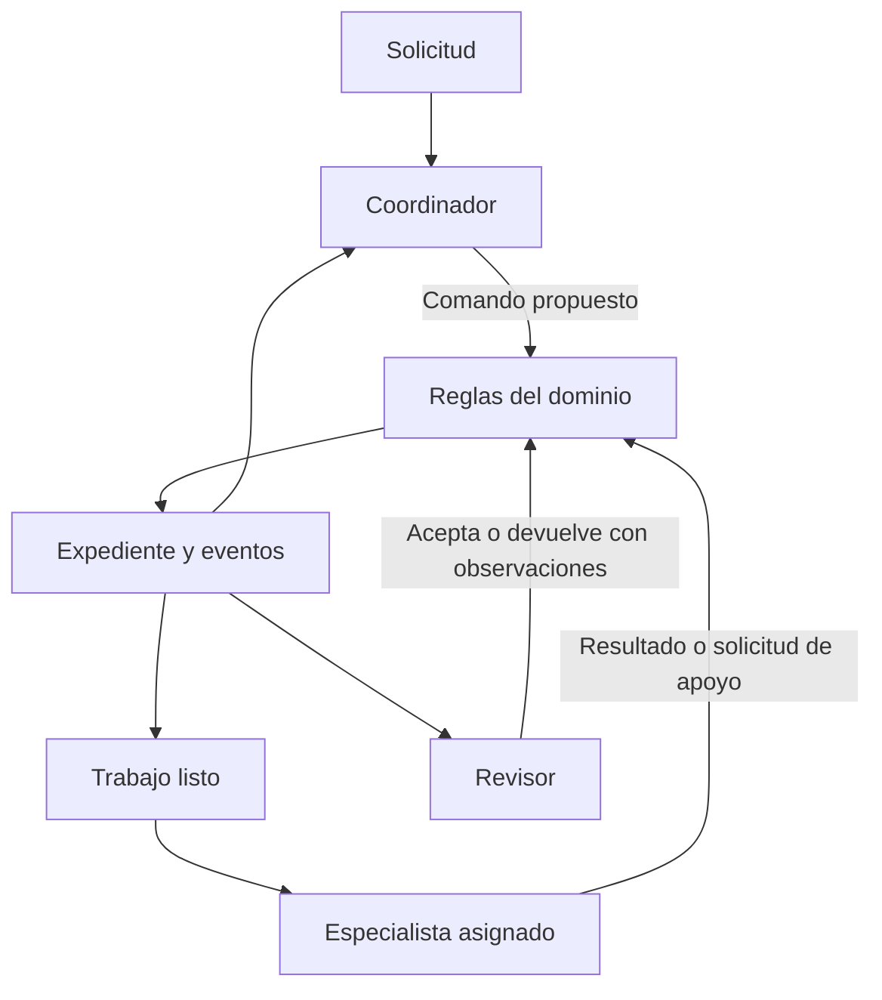

# Arquitectura de la oficina Veridis

Fecha original: 2026-10-22. Actualizado: 2026-10-24. Fase: Arranque. Este documento explica el
protocolo y los mecanismos del motor — **quién decide, cómo pasa el turno de un agente a otro,
qué puede hacer cada uno de verdad**. Para el contrato HTTP, la autenticación y el detalle de
despliegue, ver [runtime-pilot.md](runtime-pilot.md); para qué herramientas nuevas se priorizan,
[assistant-v1-roadmap.md](assistant-v1-roadmap.md) — ese es ahora el inventario vivo de
herramientas reales, no la lista fija de la sección de abajo.

**Esto dejó de ser solo simulación.** Con `VERIDIS_OFFICE_ENABLED=true` (ver runtime-pilot.md),
el protocolo descrito aquí corre con IA real, Postgres real y, para quien tenga las herramientas
correspondientes en `allowedTools`, efectos reales (un correo, un archivo, un evento). La
distinción que sigue importando no es "simulación vs. real" — ya es real — sino **qué
herramientas son de solo lectura/cómputo y cuáles tienen efecto secundario real**, ver más abajo.

La [organización empresarial](company-organization.md) amplía esta arquitectura con departamentos, responsables y especialistas. CEO coordina el expediente; CFO, CTO, COO, PM, CMO, CM y RH pueden preparar planes dentro de su ámbito. Las asignaciones departamentales se validan de forma atómica y la revisión se restringe al área correspondiente o a Calidad.

## Objetivo y entregas

Veridis coordina especialistas que comparten hallazgos, piden apoyo y revisan entregables hasta cumplir un objetivo verificable. El avance se mide por subtareas y criterios de aceptación. Los agentes se activan cuando tienen trabajo disponible.

| Entrega | Resultado comprobable | Estado |
| --- | --- | --- |
| 1. Contratos y reglas | Expediente, capacidades, dependencias, apoyo, revisión y cierre | Implementada |
| 2. Coordinación con LangGraph | El coordinador decide; nodos validan y ejecutan; checkpoints y preguntas humanas | Implementada, con IA y Postgres reales |
| 3. Servicios concurrentes | API gobernada, autorización, repositorios PostgreSQL | Implementada — ver [runtime-pilot.md](runtime-pilot.md) |
| 4. Especialistas conectados | Herramientas reales de operación, datos, documentos y comunicación | Implementada para 20 de 56 perfiles — ver tabla abajo y [assistant-v1-roadmap.md](assistant-v1-roadmap.md) |

La prioridad funcional acordada sigue siendo coordinación de operación y desarrollo, operación especializada y después desarrollo especializado.

## Núcleo de dominio implementado

`src/office/contracts.ts` define esquemas estrictos y versionados para el expediente, las tareas, evidencias, criterios, revisiones, actores y comandos. `registry.ts` registra agentes por identidad y capacidades sin un enum cerrado de agentes. `engine.ts` valida las transiciones mediante una función pura. `demo.ts` recorre un caso de colaboración con bloqueo, apoyo, corrección y cierre.

Cada expediente pertenece a un `workspaceId`, tiene un objetivo, criterios y límites. Cada tarea tiene un responsable, una capacidad requerida, dependencias y criterios propios. El número de revisión del expediente aumenta con cada comando aceptado. Un evento conserva el actor y el comando para consultar el historial; las entregas anteriores permanecen en esos eventos aunque la tarea conserve solo la última propuesta.

El registro conserva una versión por agente. El workflow guarda `office.v1`, una instantánea serializada del registro y sus límites, y la huella de la política resuelta de modelos. Al reanudar rechaza cambios en esa configuración para no reinterpretar trabajos pendientes. La [selección por agente, tarea y etapa](model-routing.md) está implementada. No hay carga dinámica de plugins ni ejecución simultánea de versiones distintas. Los prompts y herramientas requieren una política adicional de versionado antes de producción.



El ciclo del diagrama está implementado en `src/office/workflow.ts`. `workflow-demo.ts` toma decisiones deterministas según el expediente. `intelligence.ts` ofrece decisiones estructuradas con perfiles de modelos independientes para coordinador, especialistas y revisor, mediante OpenAI, Anthropic o Google; todavía no se ha ejecutado una llamada real. La simulación original `demo.ts` sigue disponible para probar el núcleo aislado.

## Protocolo y autoridad

| Comando | Actor permitido | Efecto |
| --- | --- | --- |
| `add_task` | Coordinador o responsable autorizado del equipo | Crea una tarea con responsable capaz y dependencias válidas |
| `start_task` | Especialista asignado | Comienza cuando las dependencias están completadas |
| `request_support` | Especialista asignado | Registra pregunta y capacidad requerida; bloquea su tarea |
| `resolve_block` | Coordinador | Documenta la resolución y, si corresponde, añade dependencias de apoyo |
| `submit_result` | Especialista asignado | Entrega evidencias y deja la tarea en revisión |
| `review_task` | Otro agente con capacidad de revisión | Evalúa todos los criterios; acepta o devuelve observaciones |
| `close_order` | Coordinador | Cierra si las tareas y los criterios del objetivo están completos |
| `pause_order` | Coordinador | Pausa y registra el motivo, incluso al agotar los pasos |

Las dependencias son acíclicas. Una tarea bloqueada no se resuelve a sí misma ni asigna trabajo a otro agente. Al desbloquearla se conservan sus dependencias anteriores. El coordinador puede registrar contexto recibido del usuario sin crear otra tarea.

Una aceptación necesita referenciar evidencias existentes. Esta comprobación valida la estructura del argumento; **no demuestra que una fuente sea verdadera ni que un informe sea correcto**. El adaptador de revisión propone una evaluación semántica con IA, pendiente de validar. La comprobación por herramientas llegará con los especialistas. El revisor tampoco convierte los datos recibidos en instrucciones ejecutables.

El núcleo no autentica identidades. El transporte real (`runtime/`) obtiene `Actor` de una sesión autenticada y resuelve el expediente por workspace autorizado — ver [runtime-pilot.md](runtime-pilot.md). Nunca se acepta el rol o la identidad que un LLM escriba en su respuesta como prueba de autoridad. `allowedTools` es el catálogo de permisos por agente (`agents/<id>/config.json`); `execute()` solo invoca una herramienta si el agente la declara ahí. Todas viven en `src/office/tools.ts`; cualquier falla —sin credencial, cuota, red, Docker apagado, cuenta de Google sin autorizar— se trata como "sin resultado", nunca como un error que tumbe o pause `execute()`.

### Herramientas de solo lectura o cómputo (seguras de reverificar en `review()`)

- `web.search` (agentes `research`, `market-research`, `knowledge-curator`): en cascada, Brave Search real (`BRAVE_API_KEY`, índice propio) → Google Search nativo (perfil `search-google`, Gemini + `GEMINI_API_KEY`) → Wikipedia en español sin credenciales.
- `calculator` (agentes de `finance-*` y `data-analyst`): evaluador aritmético propio, sin `eval()`, solo dígitos y `+ - * / % ^ ()`.
- `cve.lookup` (agentes de `cybersecurity`): API oficial del NIST (NVD), sin credenciales.
- `code.sandbox` (agentes de `software`): corre código en un contenedor Docker efímero (`--network none`, sin credenciales del host, tmpfs propio, tope de memoria/CPU/tiempo); el código llega por stdin, nunca se monta el filesystem del host.
- `clickup.read` (agentes de `projects`): lista tareas reales de ClickUp por palabra clave, sin crear ni modificar nada.
- `email.read` (ver abajo): lee mensajes reales de la cuenta de Gmail del sistema, sin modificar nada.

### Herramientas con efecto secundario real (`review()` nunca las vuelve a ejecutar)

Detalle completo de cada una (schema exacto, scopes de OAuth, flujo de autorización) en [assistant-v1-roadmap.md](assistant-v1-roadmap.md) — esta tabla es solo el resumen de quién puede usar qué:

| Herramienta | Qué hace de verdad | Agentes con acceso hoy |
| --- | --- | --- |
| `pdf.generate` | Genera un PDF real (WeasyPrint, Docker propio), lo guarda en Postgres | `content`, `market-research`, `research`, `investment-research`, `data-analyst` |
| `email.draft` | Crea un borrador real de Gmail — **nunca envía solo** | `content` |
| `drive.upload` | Sube un archivo real a Drive (solo ve lo que crea, scope `drive.file`) | `content`, `market-research`, `research`, `investment-research`, `data-analyst` |
| `calendar.create_event` | Crea un evento real — **sí notifica a invitados reales de inmediato** | `content` |
| `sheets.create` | Crea una hoja de cálculo real con datos | `data-analyst`, `investment-research` |
| `meet.create_space` | Crea una sala real de Google Meet | `content` |
| `slides.create` | Crea una presentación real de Google Slides | `content`, `market-research` |

Todas comparten el mismo cliente OAuth2 de una cuenta de Gmail dedicada del sistema (`src/office/tools.ts`, `configureGmail()`), autorizado una sola vez vía `npm run runtime:gmail-authorize`. Ampliar `allowedTools` a más agentes es una línea en su `config.json`, sin tocar código.

Además, el contexto de `coordinate`, `execute`, `review` y `delegate` siempre incluye `now` (fecha y hora real del sistema, ISO 8601) — no es una herramienta que el modelo deba recordar invocar, es un dato que ya tiene, para que nunca tenga que adivinar qué día es hoy.

`review()` no confía en que el especialista diga haber usado una herramienta: vuelve a ejecutar, de forma independiente y con las credenciales del motor (no las del especialista), las mismas herramientas de solo lectura que la tarea tenía permitidas, y le pasa el resultado fresco al revisor para comparar — no para que confíe en el reporte ajeno. Las herramientas con efecto real (la tabla de arriba) se le **quitan** al revisor antes de esa reejecución (`SIDE_EFFECTING_TOOLS` en `src/office/intelligence.ts`): volver a "verificar" un correo o un PDF llamando la misma herramienta duplicaría el efecto real, no lo comprobaría. Esto se descubrió en vivo: antes de corregirlo, cada ronda de revisión de una tarea con `email.draft` creaba un borrador real nuevo en Gmail — el error se corrigió generalizando la exclusión a toda herramienta con efecto real, no solo a la que lo reveló.

La comprobación de permiso hoy es solo el id de la herramienta contra `allowedTools`; no hay todavía alcance por recurso ni cuota propia por llamada (las citas quedan en la evidencia que el especialista redacta, no en un registro aparte). `email.draft` solo crea borradores (nunca envía) y `calendar.create_event` es la única que notifica a terceros reales sin que un humano revise antes — decisión explícita, documentada en assistant-v1-roadmap.md, no una omisión.

## Estados y límites

Las tareas pasan de `pending` a `running`, luego a `in_review` y `completed`. Pueden quedar `blocked` si falta apoyo. Una revisión rechazada devuelve la tarea a `pending` mientras queden correcciones; al agotarlas pasa a `failed` y requiere intervención del coordinador. No se puede cerrar el expediente con tareas fallidas, bloqueadas o pendientes.

El núcleo limita tareas, pasos de coordinación y correcciones por tarea. Cuando se agotan los pasos, rechaza nuevos avances y permite al coordinador pausar con un motivo. La planificación y los reintentos del modelo necesitarán límites adicionales de tiempo, tokens y dinero. Un registro de comandos no sustituye esas mediciones.

La pausa aún no tiene un comando para continuar o cambiar presupuestos. No hay cancelación, reasignación, mensajería general ni recuperación automática de tareas fallidas. La delegación departamental sí está implementada como decisión `delegate` del coordinador, y hay doce herramientas reales (ver la sección de arriba). Las demás funciones se añadirán con casos concretos y reglas explícitas.

## Integración con LangGraph implementada

El flujo secuencial de `src/graph.ts` continúa disponible y sus checkpoints conservan su formato. La oficina usa otro workflow y el prefijo `office.v1:` en los identificadores PostgreSQL para no reinterpretar trabajos anteriores. Los comandos locales mantienen un bloqueo PostgreSQL por expediente mientras ejecutan o consultan su estado.

El ciclo es: observar el expediente → proponer decisión → validar reglas → ejecutar trabajo o revisión → volver al coordinador. Las identidades se construyen en el runtime a partir de la asignación; las respuestas del modelo no pueden incluir `Actor`. El futuro transporte deberá autenticar al usuario. Una decisión inválida se devuelve al coordinador con su error; tres rechazos acumulados pausan el expediente por defecto.

Cada nodo usa checkpoints. Las preguntas por información usan `interrupt()` y continúan con `Command({resume})`, guardando pregunta y respuesta. La decisión de preguntar se guarda antes de entrar al nodo de espera; reanudar no vuelve a consultar al coordinador para formular la misma pregunta. Esto todavía no implementa aprobación de acciones externas.

Los especialistas reciben copias de su tarea, objetivo, respuestas humanas y entregables de sus dependencias. El coordinador recibe el estado actual y los últimos doce eventos. El runtime limita por defecto a cien decisiones y cinco preguntas, además de los límites del expediente. Antes de iniciar una tarea reserva capacidad para las transiciones de inicio y resultado. Estos límites no representan un presupuesto monetario.

`test/office-workflow.test.ts` verifica apoyo, corrección, cierre, continuación con un grafo nuevo tras fallo, preguntas humanas, decisiones inválidas, límites, aislamiento por copias y cambios de versión. La prueba local usa `MemorySaver`: **no prueba persistencia tras terminar el proceso**. `test/office-postgres.test.ts` contiene la verificación PostgreSQL optativa, sin ejecutar aquí por falta de una base de pruebas. Los errores del proveedor o respuestas inválidas de especialistas dejan el nodo pendiente y requieren continuación explícita. Reintentar puede repetir una llamada de pago; no se garantiza ejecución exactamente una vez.

La salida final es el expediente con sus entregables, evaluaciones y eventos. No existe todavía una etapa adicional de síntesis narrativa para la oficina. Un agente sin ninguna herramienta en `allowedTools` sigue preparando solo propuestas con la información recibida — las referencias `proposal://` identifican ese contenido propuesto, no un archivo creado. Un agente con alguna de las doce herramientas reales sí puede producir un efecto verdadero (ver la sección de arriba); la pantalla ASISTENTE y la vista OFICINA de la interfaz web son la forma de usar esto día a día, ver [runtime-pilot.md](runtime-pilot.md).

## Persistencia: implementada; cola y workers siguen pendientes

Los checkpoints de LangGraph (`PostgresSaver`) guardan el punto de ejecución real en Postgres — ya no es una idea futura. `office_orders` indexa expedientes para listar/filtrar rápido sin leer el checkpoint completo; `office_files` guarda bytes reales (PDF); `gmail_accounts` guarda el refresh token cifrado de la cuenta de Google del sistema; `scheduled_tasks` guarda las tareas con cron real. Detalle de cada tabla en [runtime-pilot.md](runtime-pilot.md).

Lo que sigue genuinamente pendiente: una cola que transporte identificadores de trabajo con workers separados del proceso HTTP (hoy todo corre en el mismo proceso que atiende la API), claves de idempotencia explícitas para efectos externos más allá de la deduplicación por hash que ya tiene `pdf.generate`, y un outbox formal para publicar trabajos después de guardar el cambio. Un evento forma parte del expediente guardado en el checkpoint; aún no es un bus durable ni una bitácora de aplicación protegida contra cambios.

Hoy hay un único escritor por expediente (el propio proceso HTTP) y solo se paralelizan subtareas independientes dentro de un expediente. Reservas de trabajo con vencimiento, recuperación de workers caídos y manejo de resultados atrasados no existen porque no hay workers separados todavía — son necesarios para escalar más allá de un solo proceso, no para el piloto actual.

Los datos compartidos se separarán en contexto del expediente, artefactos grandes referenciados y conocimiento reutilizable con permisos, procedencia y fecha. No se reenviará todo el historial a cada agente. El contexto de apoyo incluirá resultados pertinentes y sus referencias.

## Ejecución de la simulación (sin IA ni red, para probar el núcleo aislado)

```bash
npm run demo:office
npm run office:demo
npm test
npm run check
```

La simulación no llama IA, internet, ClickUp ni sistemas de red. Todos los artefactos `demo://` son ficticios. Su resultado es un expediente completado con dos tareas revisadas, una solicitud de apoyo, una corrección y el historial de comandos. Para correr el protocolo con IA real, Postgres real y las herramientas de la tabla de arriba, ver "Preparación local" en [runtime-pilot.md](runtime-pilot.md) — `npm run runtime:serve` con `VERIDIS_OFFICE_ENABLED=true`.

## Referencias

- [LangGraph: patrones de coordinación y evaluación](https://docs.langchain.com/oss/javascript/langgraph/workflows-agents)
- [LangGraph: interrupciones persistentes](https://docs.langchain.com/oss/javascript/langgraph/interrupts)
- [LangGraph: persistencia](https://docs.langchain.com/oss/javascript/langgraph/persistence)
