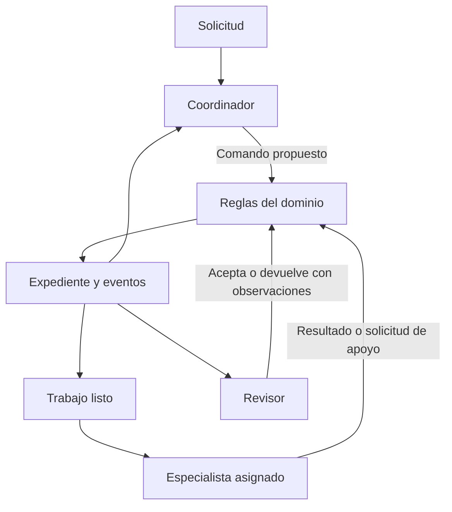

# Arquitectura de la oficina Veridis

Fecha: 2026-10-22. Fase: Arranque. Estado: núcleo de dominio y workflow LangGraph implementados; verificación PostgreSQL y proveedor pendiente.

La [organización empresarial](company-organization.md) amplía esta arquitectura con departamentos, responsables y especialistas. CEO coordina el expediente; CFO, CTO, COO, PM, CMO, CM y RH pueden preparar planes dentro de su ámbito. Las asignaciones departamentales se validan de forma atómica y la revisión se restringe al área correspondiente o a Calidad.

## Objetivo y entregas

Veridis coordinará especialistas que comparten hallazgos, piden apoyo y revisan entregables hasta cumplir un objetivo verificable. El avance se medirá por subtareas y criterios de aceptación. Los agentes se activarán cuando tengan trabajo disponible.

| Entrega | Resultado comprobable | Estado |
| --- | --- | --- |
| 1. Contratos y reglas | Expediente, capacidades, dependencias, apoyo, revisión y cierre; simulación sin APIs | Implementada en este cambio |
| 2. Coordinación con LangGraph | El coordinador decide; nodos validan y ejecutan; checkpoints y preguntas humanas | Probada en simulación; pendiente verificar PostgreSQL y proveedor |
| 3. Servicios concurrentes | API, autorización, repositorios PostgreSQL, cola y workers | Pendiente |
| 4. Especialistas conectados | Herramientas de operación, noticias, infraestructura y desarrollo | Pendiente |

La prioridad funcional acordada sigue siendo coordinación de operación y desarrollo, operación especializada y después desarrollo especializado. Infraestructura e investigación ya tienen perfiles de simulación para comprobar extensibilidad; no se ha iniciado ninguna auditoría ni búsqueda de noticias.

## Núcleo de dominio implementado

`src/office/contracts.ts` define esquemas estrictos y versionados para el expediente, las tareas, evidencias, criterios, revisiones, actores y comandos. `registry.ts` registra agentes por identidad y capacidades sin un enum cerrado de agentes. `engine.ts` valida las transiciones mediante una función pura. `demo.ts` recorre un caso de colaboración con bloqueo, apoyo, corrección y cierre.

Cada expediente pertenece a un `workspaceId`, tiene un objetivo, criterios y límites. Cada tarea tiene un responsable, una capacidad requerida, dependencias y criterios propios. El número de revisión del expediente aumenta con cada comando aceptado. Un evento conserva el actor y el comando para consultar el historial; las entregas anteriores permanecen en esos eventos aunque la tarea conserve solo la última propuesta.

El registro conserva una versión por agente. El workflow guarda `office.v1`, una instantánea serializada del registro y sus límites, y la huella de la política resuelta de modelos. Al reanudar rechaza cambios en esa configuración para no reinterpretar trabajos pendientes. La [selección por agente, tarea y etapa](model-routing.md) está implementada. No hay carga dinámica de plugins ni ejecución simultánea de versiones distintas. Los prompts y herramientas requieren una política adicional de versionado antes de producción.



El ciclo del diagrama está implementado en `src/office/workflow.ts`. `workflow-demo.ts` toma decisiones deterministas según el expediente. `intelligence.ts` ofrece decisiones estructuradas con perfiles de modelos independientes para coordinador, especialistas y revisor, mediante OpenAI, Anthropic o Google; todavía no se ha ejecutado una llamada real. La simulación original `demo.ts` sigue disponible para probar el núcleo aislado.

## Protocolo y autoridad

| Comando | Actor permitido | Efecto |
| --- | --- | --- |
| `add_task` | Coordinador o responsable autorizado del equipo | Crea una tarea con responsable capaz y dependencias válidas |
| `start_task` | Especialista asignado | Comienza cuando las dependencias están completadas |
| `request_support` | Especialista asignado | Registra pregunta y capacidad requerida; bloquea su tarea |
| `resolve_block` | Coordinador | Documenta la resolución y, si corresponde, añade dependencias de apoyo |
| `submit_result` | Especialista asignado | Entrega evidencias y deja la tarea en revisión |
| `review_task` | Otro agente con capacidad de revisión | Evalúa todos los criterios; acepta o devuelve observaciones |
| `close_order` | Coordinador | Cierra si las tareas y los criterios del objetivo están completos |
| `pause_order` | Coordinador | Pausa y registra el motivo, incluso al agotar los pasos |

Las dependencias son acíclicas. Una tarea bloqueada no se resuelve a sí misma ni asigna trabajo a otro agente. Al desbloquearla se conservan sus dependencias anteriores. El coordinador puede registrar contexto recibido del usuario sin crear otra tarea.

Una aceptación necesita referenciar evidencias existentes. Esta comprobación valida la estructura del argumento; **no demuestra que una fuente sea verdadera ni que un informe sea correcto**. El adaptador de revisión propone una evaluación semántica con IA, pendiente de validar. La comprobación por herramientas llegará con los especialistas. El revisor tampoco convierte los datos recibidos en instrucciones ejecutables.

El núcleo no autentica identidades. El futuro transporte deberá obtener `Actor` de un contexto autenticado y resolver el expediente por workspace autorizado. Nunca se aceptará el rol o la identidad que un LLM escriba en su respuesta como prueba de autoridad. `allowedTools` es un catálogo declarativo; el futuro ejecutor deberá comprobar permisos, recursos autorizados y argumentos en cada llamada.

## Estados y límites

Las tareas pasan de `pending` a `running`, luego a `in_review` y `completed`. Pueden quedar `blocked` si falta apoyo. Una revisión rechazada devuelve la tarea a `pending` mientras queden correcciones; al agotarlas pasa a `failed` y requiere intervención del coordinador. No se puede cerrar el expediente con tareas fallidas, bloqueadas o pendientes.

El núcleo limita tareas, pasos de coordinación y correcciones por tarea. Cuando se agotan los pasos, rechaza nuevos avances y permite al coordinador pausar con un motivo. La planificación y los reintentos del modelo necesitarán límites adicionales de tiempo, tokens y dinero. Un registro de comandos no sustituye esas mediciones.

La pausa aún no tiene un comando para continuar o cambiar presupuestos. No hay cancelación, reasignación, mensajería general, hallazgos independientes, herramientas externas ni recuperación automática de tareas fallidas. La delegación departamental sí está implementada como decisión `delegate` del coordinador. Las demás funciones se añadirán con casos concretos y reglas explícitas.

## Integración con LangGraph implementada

El flujo secuencial de `src/graph.ts` continúa disponible y sus checkpoints conservan su formato. La oficina usa otro workflow y el prefijo `office.v1:` en los identificadores PostgreSQL para no reinterpretar trabajos anteriores. Los comandos locales mantienen un bloqueo PostgreSQL por expediente mientras ejecutan o consultan su estado.

El ciclo es: observar el expediente → proponer decisión → validar reglas → ejecutar trabajo o revisión → volver al coordinador. Las identidades se construyen en el runtime a partir de la asignación; las respuestas del modelo no pueden incluir `Actor`. El futuro transporte deberá autenticar al usuario. Una decisión inválida se devuelve al coordinador con su error; tres rechazos acumulados pausan el expediente por defecto.

Cada nodo usa checkpoints. Las preguntas por información usan `interrupt()` y continúan con `Command({resume})`, guardando pregunta y respuesta. La decisión de preguntar se guarda antes de entrar al nodo de espera; reanudar no vuelve a consultar al coordinador para formular la misma pregunta. Esto todavía no implementa aprobación de acciones externas.

Los especialistas reciben copias de su tarea, objetivo, respuestas humanas y entregables de sus dependencias. El coordinador recibe el estado actual y los últimos doce eventos. El runtime limita por defecto a cien decisiones y cinco preguntas, además de los límites del expediente. Antes de iniciar una tarea reserva capacidad para las transiciones de inicio y resultado. Estos límites no representan un presupuesto monetario.

`test/office-workflow.test.ts` verifica apoyo, corrección, cierre, continuación con un grafo nuevo tras fallo, preguntas humanas, decisiones inválidas, límites, aislamiento por copias y cambios de versión. La prueba local usa `MemorySaver`: **no prueba persistencia tras terminar el proceso**. `test/office-postgres.test.ts` contiene la verificación PostgreSQL optativa, sin ejecutar aquí por falta de una base de pruebas. Los errores del proveedor o respuestas inválidas de especialistas dejan el nodo pendiente y requieren continuación explícita. Reintentar puede repetir una llamada de pago; no se garantiza ejecución exactamente una vez.

La salida final es el expediente con sus entregables, evaluaciones y eventos. No existe todavía una etapa adicional de síntesis narrativa para la oficina. No hay ejecución real de herramientas; los agentes solo preparan propuestas con la información recibida. Las referencias `proposal://` identifican contenido propuesto, no archivos creados.

## Persistencia y distribución: diseño pendiente

Los checkpoints guardarán el punto de ejecución de LangGraph. Los expedientes, tareas, eventos, entregables y autorizaciones tendrán tablas de aplicación propias. La cola transportará identificadores de trabajo; los workers cargarán el contexto permitido desde los repositorios.

La escritura del expediente usará la revisión esperada para impedir actualizaciones perdidas. Se necesitarán claves de idempotencia para comandos y efectos externos, transacciones y un outbox para publicar trabajos después de guardar el cambio. Un evento forma parte del expediente guardado en el checkpoint; aún no es un bus durable ni una bitácora de aplicación protegida contra cambios.

La primera implementación podrá mantener un único escritor por expediente y paralelizar únicamente subtareas independientes. Antes de hacerlo se definirán reservas de trabajo con vencimiento, recuperación de workers caídos y manejo de resultados atrasados. Los límites se aplicarán por workspace, herramienta y proveedor. PostgreSQL compartido por sí solo no resuelve estos problemas.

Los datos compartidos se separarán en contexto del expediente, artefactos grandes referenciados y conocimiento reutilizable con permisos, procedencia y fecha. No se reenviará todo el historial a cada agente. El contexto de apoyo incluirá resultados pertinentes y sus referencias.

## Ejecución de la simulación

```bash
npm run demo:office
npm run office:demo
npm test
npm run check
```

La simulación no llama IA, internet, ClickUp ni sistemas de red. Todos los artefactos `demo://` son ficticios. Su resultado es un expediente completado con dos tareas revisadas, una solicitud de apoyo, una corrección y el historial de comandos.

## Referencias

- [LangGraph: patrones de coordinación y evaluación](https://docs.langchain.com/oss/javascript/langgraph/workflows-agents)
- [LangGraph: interrupciones persistentes](https://docs.langchain.com/oss/javascript/langgraph/interrupts)
- [LangGraph: persistencia](https://docs.langchain.com/oss/javascript/langgraph/persistence)
